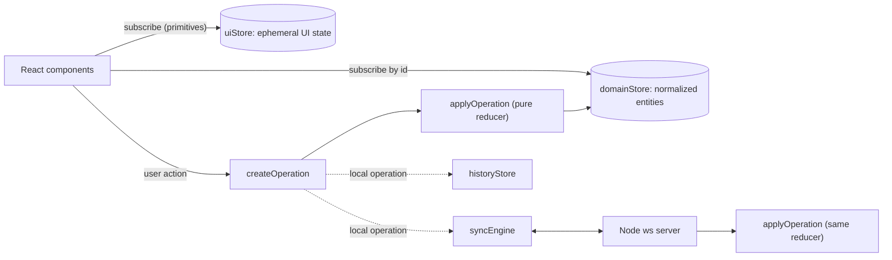
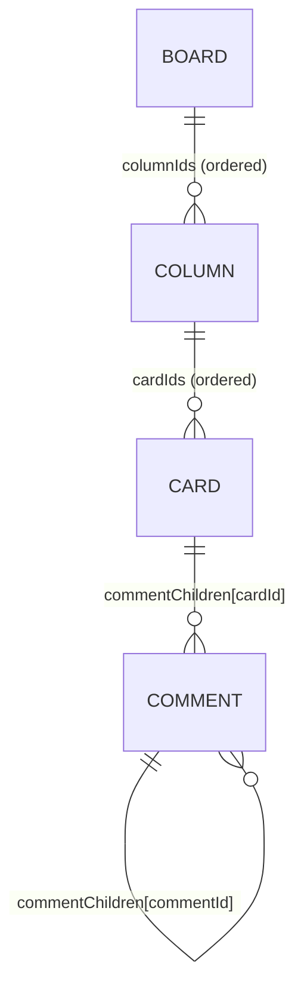
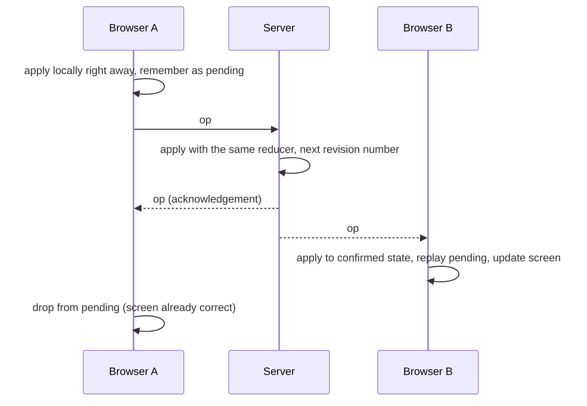

# CollabBoard

A collaborative workspace for managing ideas and execution. Create boards, organize work in columns, and track cards with Markdown descriptions, tags, due dates and threaded comments. Drag cards between columns, undo mistakes, and watch other people's changes appear live.

Built for the Talenvo residency: **Stage 1** is the core board system, **Stage 2** (this version) adds scalability, collaboration and production maturity.

| | |
|---|---|
| **Live app** | https://collab-board-rho-seven.vercel.app |
| **Realtime server** | https://collab-board-d2xt.onrender.com (health check: `/health`) |
| **Repository** | https://github.com/Akanimo-Umoh/collab-board |

## Try the collaboration

1. Open the live app in two browsers (or one normal window and one private window).
2. Wait for the **Live** pill at the bottom left. The realtime server runs on a free tier that sleeps when idle, so the first connection can take up to a minute ("Connecting…"). The app works locally in the meantime and syncs when the server wakes.
3. Create a board in one window. It appears in the other. Add cards, drag them, comment on them.

Each browser tab gets its own anonymous guest identity (kept per tab), so two tabs behave like two different people. Everyone who opens the live app shares one workspace.

## Features

**Stage 1: core board system**

- **Dashboard:** list boards (title, description, created date), create a board, delete a board with confirmation.
- **Board view:** create, rename (inline) and delete columns.
- **Cards:** create, edit and delete cards with a title, a Markdown description (rendered and sanitized), multiple tags and a due date.

**Stage 2: collaboration and production maturity**

- **Drag and drop** within and across columns with mouse, touch and pen, plus a full keyboard and screen reader path. Order is preserved in state and synced.
- **Real-time collaboration** over a WebSocket server: card creation, edits, moves and comments appear in every open session. Optimistic UI with server reconciliation.
- **Threaded comments** with nested replies (5 levels offered in the UI, unlimited in the data model), edit and delete.
- **Undo and redo** for creating, deleting, moving and editing cards (Ctrl/Cmd+Z, Ctrl/Cmd+Shift+Z).
- **Product polish:** dark mode on theme tokens, toast notifications, loading skeletons, error boundaries, empty states, and a small design system (`Button`, `IconButton`, `TextField`, `Input`, `Textarea`, `Badge`, `Modal`, `Skeleton`, `EmptyState`).
- **Performance lab:** add `?perf` to a board URL to seed 200+ cards across 20+ columns and benchmark the app yourself.
- **Automated tests:** 101 tests across 10 files, including keyboard-driven integration tests of the board.

## Requirements checklist

| Requirement | How it is met |
|---|---|
| React + TypeScript (Vite), strict mode | React 19, Vite 8, TypeScript with `"strict": true` |
| No UI libraries, no template starter | Every component is hand-written; Tailwind CSS v4 utilities only |
| No drag-and-drop library | Custom Pointer Events and keyboard implementation ([trade-off analysis](docs/TRADEOFFS.md)) |
| State management decision explained | [State architecture](#state-architecture) and the [architecture evolution document](docs/ARCHITECTURE_EVOLUTION.md) |
| Normalized state, UI state separated from domain state | Flat entity maps in `domainStore`; ephemeral state in `uiStore` |
| Lazy-loaded board page | `React.lazy` in `App.tsx` |
| Accessibility | [Accessibility](#accessibility) |
| WebSocket server, optimistic UI, conflict handling | Node `ws` server, operation log, [documented conflict rules](docs/REALTIME.md) |
| Undo/redo without full-state cloning | Command pattern over inverse operations |
| 200+ cards, 20+ columns, active threads | [Performance strategy](#performance-strategy) and [benchmarks](docs/PERFORMANCE.md) |
| Unit tests (drag, undo/redo, comments) and an integration test | [Testing](#testing) |
| Architecture evolution document | [docs/ARCHITECTURE_EVOLUTION.md](docs/ARCHITECTURE_EVOLUTION.md) |

## Tech stack

React, Vite, TypeScript, Tailwind CSS v4, Zustand, React Router, `marked` + `DOMPurify`. Server: Node.js with `ws`. Tests: Vitest, Testing Library, jsdom. No UI component library, no template starter, no drag-and-drop library.

## Getting started

Use a current Node LTS (24 recommended). Older Node versions cannot start the test workers.

```bash
pnpm install
pnpm dev          # the app on http://localhost:5173 (works on its own, local-only)
```

To run with real-time collaboration locally, start the server in a second terminal and point the app at it:

```bash
pnpm dev:server   # realtime server on ws://localhost:8787
```

Create a file named `.env.local` (it is git-ignored) containing:

```
VITE_WS_URL=ws://localhost:8787
```

Restart `pnpm dev`, then open the app in two browser windows. Without `VITE_WS_URL` the app runs local-only with no sync.

| Script | What it does |
|---|---|
| `pnpm dev` | Start the Vite dev server |
| `pnpm build` | Type-check and build for production |
| `pnpm preview` | Serve the production build locally |
| `pnpm lint` | ESLint, including `jsx-a11y` rules |
| `pnpm format` / `pnpm format:check` | Prettier |
| `pnpm test` / `pnpm test:watch` | Run the Vitest suite |
| `pnpm dev:server` | Realtime server with auto-restart |
| `pnpm server` | Realtime server (what the host runs) |
| `pnpm typecheck:server` | Type-check the server |

| Environment variable | Used by | Meaning |
|---|---|---|
| `VITE_WS_URL` | App (build time) | WebSocket URL of the realtime server. Unset means local-only mode |
| `PORT` | Server | Port to listen on (default 8787; the host sets it) |
| `ALLOWED_ORIGINS` | Server | Comma-separated page origins allowed to connect. Empty allows any (local development) |

## Folder structure

```
server/                 Node WebSocket server: authoritative state, ordering, broadcast
docs/                   Architecture evolution, real-time design, performance, trade-offs
src/
├── app/            AppLayout (header, theme toggle, skip link, route focus, error boundary), Logo, RouteFallback
├── components/
│   ├── ui/         Design system: Button, IconButton, TextField, Input/Textarea, Badge, Modal,
│   │               ConfirmDialog, Skeleton, EmptyState, ThemeToggle, ToastViewport, icons
│   └── *Error*     ErrorBoundary, PageErrorFallback, RootErrorFallback
├── features/
│   ├── boards/     BoardList, BoardCard, BoardListSkeleton, CreateBoardDialog, DeleteBoardDialog
│   ├── columns/    Column, ColumnHeader, ColumnTitleEditor, AddColumnForm, DeleteColumnDialog, BoardSkeleton
│   ├── cards/      CardItem, AddCardButton, CardForm, CardDetailModal, CreateCardModal, CardModalHost,
│   │               DeleteCardDialog, MarkdownView, TagInput, TagList
│   ├── comments/   CommentSection, CommentItem, CommentForm, usePagedIds
│   ├── dnd/        pointerDrag, keyboardDrag, DragHandle, DragPreview, DragAnnouncer, positions, persistMove
│   ├── history/    HistoryControls (undo/redo buttons)
│   └── realtime/   ConnectionStatus (Live / Connecting / Offline pill)
├── history/        Undo/redo: commands (inverse operations), historyStore, shortcuts, recorder
├── realtime/       Operation model and pure reducer, sync engine, transport, protocol (shared with the server)
├── store/
│   ├── domain/     domainStore: normalized entities and actions (persisted)
│   ├── ui/         uiStore (ephemeral UI state), toastStore, themeStore, announcerStore
│   └── hooks.ts    narrow entity selector hooks
├── hooks/          useFocusTrap
├── lib/            Pure helpers: ordering, dnd geometry, comments, identity, debounced storage, markdown, cn, date, id, records, tags
├── perf/           Opt-in performance lab (seed data, benchmarks, React Profiler hook)
├── pages/          DashboardPage, BoardPage (lazy loaded), NotFoundPage
├── test/           Test setup, fixtures and helpers
├── types/          domain.ts
├── App.tsx         Route table only
├── index.css       Tailwind v4, light and dark design tokens, board styles
└── main.tsx        Starts history and realtime, mounts the app under the root error boundary
```

- `components/ui` knows nothing about boards or cards, so primitives stay reusable and feature folders stay small.
- `features/*` own their domain UI. Pages only compose features and hold no domain logic.
- `store/domain` and `store/ui` are separate folders so the domain/UI split is enforced by structure.
- `src/realtime/operations.ts` and `protocol.ts` are imported by both the browser and the server, so there is one definition of what a change is and how it is applied.

## State architecture



### Normalized domain state



```ts
interface DomainSnapshot {
  boardOrder: ID[]
  boards: Record<ID, Board>        // Board.columnIds: ID[]
  columns: Record<ID, Column>      // Column.boardId, Column.cardIds: ID[]
  cards: Record<ID, Card>          // Card.columnId
  comments: Record<ID, CardComment> // CardComment.cardId, parentId
  commentChildren: Record<ID, ID[]> // ordered child ids of a card (top-level) or of a comment (replies)
}
```

- Flat maps keyed by ID, with no nesting. Updating a card touches `cards[id]` only; nothing above it is rebuilt.
- Parents own ordering through ID arrays, and children point back to their parent by ID.
- State is serializable only (ISO strings, no functions).
- Cascade deletes (board, column, card with its comment thread) happen in one reducer step, so there are no orphans and no intermediate renders.
- Because every entity is addressed by ID, one change is one keyed update. This is the shape that made real-time possible without restructuring.

### Domain vs UI state

`useDomainStore` holds the data. `useUIStore` holds ephemeral UI state: which card dialog is open, which column is being renamed, what awaits delete confirmation, the drag in progress, the connection status and whether the first sync is still pending. It stores IDs only, never copies of entities, so there is one source of truth. Toasts, theme and screen reader announcements have their own tiny stores. Form drafts and one-page flags stay in local `useState`, because only one component cares.

### Every change is an operation

Each user action becomes a small, serializable **operation** (`card.move`, `comment.add`, …) applied by one pure function, `applyOperation(state, op)`. The same function runs in the browser (optimistically), on the server (authoritatively) and in undo/redo. That single decision is what makes real-time, undo and the test suite simple. See [docs/ARCHITECTURE_EVOLUTION.md](docs/ARCHITECTURE_EVOLUTION.md).

### Why Zustand

- **Context + `useReducer`** re-renders every consumer on any change, which works against the performance requirements unless contexts are split heavily.
- **Redux Toolkit** would work (`createEntityAdapter` normalizes), but its boilerplate is heavy for this scope.
- **Zustand** gives selector-based subscriptions, so a component re-renders only when the slice it selected changes, with no providers and no prop drilling. It also works outside React, which the sync engine, the drag controller and the tests rely on.

## Real-time collaboration



The server is the single source of order. Each client keeps **confirmed** state (what the server has told it) plus **pending** operations (its own, not yet acknowledged) and shows `confirmed + pending`. A remote change is applied to confirmed state and pending operations are replayed on top.

**Two users edit the same card: what wins, and why?**

| Situation | Outcome | Why |
|---|---|---|
| Different fields (title vs tags) | Both survive | Edits send only the fields that changed |
| The same field | The edit the server received last wins | One server order means every client converges; client clocks cannot be trusted |
| One edits, one deletes | Delete wins | An edit to something that no longer exists has nowhere to land; undo can restore it |
| Both move the same card | The last move wins | Moves are anchored to a neighbouring card, not an index, so concurrent inserts do not shift them |
| Both create cards in one column | Both survive, in server order | Creation never conflicts |
| Reply to a comment someone just deleted | Reply is kept | Deleted comments leave a tombstone so threads never orphan |

Details, failure modes and the protocol are in [docs/REALTIME.md](docs/REALTIME.md).

## Drag and drop

Built from scratch with Pointer Events, with no library.

- **Mouse, touch and pen:** drag a card anywhere on it (touch uses the grip handle so scrolling still works). A card-shaped placeholder shows where it will land, the cursor changes to "grabbing" over columns and "not allowed" elsewhere, and the board and the column under the pointer auto-scroll near their edges.
- **Keyboard:** focus a card's grip handle, press Space or Enter to pick it up, arrow keys to move it (up/down within a column, left/right across columns), Space or Enter to drop, Escape to cancel. A live region announces every step.
- **No re-render per pixel:** the floating preview moves with a DOM transform; the drop position is stored only when it changes; hit-testing is throttled with `requestAnimationFrame` and uses binary search.
- **One operation per drop:** keyboard moves are local previews, and only the final drop is sent to other sessions.
- Listeners are attached when a drag starts and removed on drop, cancel and unmount.

Why custom instead of a library: [docs/TRADEOFFS.md](docs/TRADEOFFS.md).

## Undo and redo

A command-style history, not state snapshots. Each undoable action stores the operations that perform it and the operations that reverse it, computed once from the state just before the action. Undo dispatches the inverse as new operations, so other sessions see it like any other change.

- Covers creating, deleting (with the card's whole comment thread), moving and editing cards.
- **It reverses only your own actions.** A teammate's concurrent edit is never undone by your Ctrl+Z, and undoing an edit restores only the fields you changed.
- If someone else already changed the thing, undo fails honestly with a message and drops the entry.
- Shortcuts are ignored while typing in a field, while a dialog is open, or mid-drag. Delete toasts carry an Undo button. History is capped at 100 entries and is cleared when you leave the board.

## Performance strategy

Target: stay responsive with 200+ cards, 20+ columns and active comment threads.

- **Code splitting:** `BoardPage` is loaded with `React.lazy` behind a `Suspense` boundary inside the layout, so the dashboard never downloads the board code or the Markdown libraries. The performance lab is a separate lazy chunk that normal users never load.
- **IDs down, not objects.** Lists select only ID arrays, and each child subscribes to its own entity (`BoardCard`, `Column`, `ColumnHeader`, `CardItem`, `CommentItem`). Memoized components receive primitive props, so `memo` actually works.
- **Narrow selectors.** A drag uses primitive selectors (a boolean per card, an index per column), so it re-renders the old and new target column, not the board. Reordering inside a column rewrites one ID array and leaves card objects untouched.
- **Strategic memoization.** `memo` wraps list items. `useMemo` is used where work is genuinely expensive: parsing and sanitizing Markdown. `useCallback` is deliberately not sprinkled around, because handlers go to native elements or non-memoized components, where stable identity buys nothing.
- **No-op updates keep the same state reference**, so Zustand does not notify subscribers.
- **Batched store writes:** seeding or undoing many operations is one store update and one render.
- **Debounced persistence:** the state is saved to `localStorage` 300 ms after changes stop (and when the tab is hidden), instead of serializing everything on every change.
- **Large comment threads** show the latest 30 comments (15 replies per comment) with a "Show earlier" button. Deleting a card with a very deep thread is iterative, never recursive.
- **Remote bursts** collapse into a summary toast instead of hundreds of toasts.
- Dialogs are mounted only while open. `Intl.DateTimeFormat` is created once at module level. `useFocusTrap` keeps its callback in a ref so the effect does not re-run and steal focus.

**Measured** with the built-in lab (24 columns, 240 cards, 360 comments), Chrome on Windows:

| Measurement | Production build | Development build |
|---|---|---|
| Apply 624 seed operations | 36.3 ms | 47–71 ms (1 React commit) |
| Board painted after the seed | 177.8 ms | 662–738 ms |
| One card move, main-thread cost (render + layout) | median 2.4 ms, p95 3.7 ms | median 8.9 ms, p95 11.6 ms |
| React commits per move | n/a | 1.0 |
| Add a comment | 0.3 ms | 0.8 ms (0 board renders) |

Full method, caveats and the virtualization decision are in [docs/PERFORMANCE.md](docs/PERFORMANCE.md).

**To see it yourself:** open a board with `?perf` added to the URL, expand "Performance lab", click **Seed**, then **Run benchmarks**. For React DevTools, record the Profiler while dragging a card: only the dragged card and its preview render; every other card shows "did not render".

## Accessibility

- **Semantics:** landmarks (`header`, `main`), one `h1` per page, `h2` for boards and columns, real lists, `<section aria-label>` for columns, `<time dateTime>`, and native buttons and links.
- **Skip link** as the first tab stop, and focus moves to the main content after in-app navigation.
- **Dialogs:** `role="dialog"` (`alertdialog` for destructive confirmations), `aria-modal`, `aria-labelledby`/`aria-describedby`, rendered in a portal, with page scroll locked while open.
- **Keyboard and focus:** a hand-built focus trap (Tab and Shift+Tab cycle, Escape closes only the topmost dialog, and focus returns to the element that opened it). Confirmation dialogs start on Cancel. Cards can be moved entirely by keyboard.
- **Forms:** labels tied with `htmlFor`, `aria-invalid`, `aria-describedby`, `role="alert"` errors, and focus moved to the first invalid field.
- **Icon buttons** require a `label` prop in their type, so an unnamed icon button will not compile. Labels include context ("Delete board Roadmap").
- **Live regions** announce creations, deletions, comment actions and every step of a keyboard drag. Toasts are polite live regions (errors use `role="alert"`) that pause while hovered or focused.
- **Undo/redo buttons** use `aria-disabled` so keyboard focus is not lost when a stack empties, and they name what the next step will do.
- **Loading and errors:** skeletons are announced as a single "Loading…" status; the error boundary moves focus to its message.
- Global `:focus-visible` ring (re-coloured for dark mode), `motion-safe` animations, light and dark themes built on tokens, and `eslint-plugin-jsx-a11y` in the lint config.

## Testing

`pnpm test` runs **101 tests in 10 files** with Vitest, Testing Library and jsdom.

| Area | What is verified |
|---|---|
| Drag logic | Drop-position search, edge auto-scroll speeds, card reordering and cross-column moves, keyboard targets, no input mutation |
| Operations and conflicts | Field-level merge, delete-wins, anchored moves surviving concurrent inserts, idempotent duplicates, cascades |
| Comments | Nesting, validation, author-only edit/delete, tombstones, a 20,000-deep thread deleted without overflowing the stack |
| Undo/redo | Every inverse restores the exact earlier state; undo leaves a teammate's edit alone; failure when someone else changed things |
| Storage | Debounced writes merge, flush when the tab is hidden |
| Integration | A real board page driven by the keyboard (pick up, move, drop, cancel, exactly one operation sent per drop) and a full comment thread in the card dialog (add, reply, edit, delete, "show earlier") |

The pointer drag path depends on layout APIs jsdom does not implement, so it is covered through its pure helpers and by the keyboard integration tests; an end-to-end browser test would be the next addition.

## Key engineering decisions

- **Hand-built modal and focus trap** instead of a headless library, because focus management is a graded requirement and this keeps behavior fully understood and tested.
- **One Markdown choke point:** `lib/markdown.ts` parses with `marked` and sanitizes with `DOMPurify`. The only `dangerouslySetInnerHTML` in the app receives its output.
- **Due dates are stored as `YYYY-MM-DD` strings** and formatted from their parts, which avoids the timezone off-by-one that `new Date('2026-10-20')` causes.
- **Tags are a `string[]` on the card.** At this scope tags have no identity or attributes of their own, so a normalized tag table would be extra structure with no benefit.
- **Ordering lives on the parent** (`columnIds`, `cardIds`) so reordering is a single array operation. Over the wire, a move names the card it should sit after rather than an index, which keeps it correct under concurrency.
- **Operations plus a pure reducer** shared by client, server and undo, instead of mutating actions.
- **Server-ordered real-time, not peer-to-peer:** one authority gives one order, so every client converges. Wall-clock timestamps are never used to decide winners.
- **Undo reverses your own actions only**, as new operations, instead of rewinding shared state.
- **Custom drag and drop** with a first-class keyboard path, instead of the native HTML5 drag API (no touch or keyboard support) or a library.
- **Soft-deleted comments (tombstones)** so replies never orphan and delete-versus-reply races are harmless.
- **`localStorage` persistence** through Zustand's `persist` with `partialize` and a debounced writer, so only data is saved and never actions or UI state.
- **Design tokens in Tailwind's `@theme`**, with dark mode as an override of the same token names: one source for color, radius and shadow.

## Known limitations

The full, prioritized list is in [docs/ARCHITECTURE_EVOLUTION.md](docs/ARCHITECTURE_EVOLUTION.md#technical-debt). The headline items:

- The realtime server keeps state in memory, runs as a single process on a free tier that sleeps, and has no authentication. It is a faithful simulation of the architecture, not a production backend.
- Operations a user makes while offline are not saved across a page reload, so they can be lost if the tab is closed before reconnecting.
- Undo covers cards only (not boards, columns or comments), and multi-step undos are not atomic for other viewers.
- No list virtualization. The measurements show it is not needed at this size, and the doc explains the plan if it becomes necessary.
- Touch drag starts from the grip handle (the rest of the card scrolls the page).

## Deployment

- **App (Vercel):** a static Vite build. `vercel.json` rewrites every path to `index.html` for client-side routing. Set the environment variable `VITE_WS_URL` to the realtime server, for example `wss://collab-board-d2xt.onrender.com` (note `wss://`, not `https://`).
- **Realtime server (Render, free web service):** Build command `pnpm install --frozen-lockfile --prod=false`, start command `pnpm run server`. Set `ALLOWED_ORIGINS` to the Vercel site origin. `/health` returns `ok` for health checks and uptime monitoring.
- The server starts empty. The first browser to connect seeds it from its local copy, and the state is held in memory until the next restart.

## Documentation

| Document | Contents |
|---|---|
| [docs/ARCHITECTURE_EVOLUTION.md](docs/ARCHITECTURE_EVOLUTION.md) | What broke when adding real-time, how the state changed, technical debt, a three-week refactor plan, how this scales to 10,000 users |
| [docs/REALTIME.md](docs/REALTIME.md) | Protocol, optimistic UI and reconciliation, conflict rules (what wins and why), failure modes |
| [docs/PERFORMANCE.md](docs/PERFORMANCE.md) | Benchmark method and results, profiler evidence, virtualization decision |
| [docs/TRADEOFFS.md](docs/TRADEOFFS.md) | Custom drag and drop versus a library |