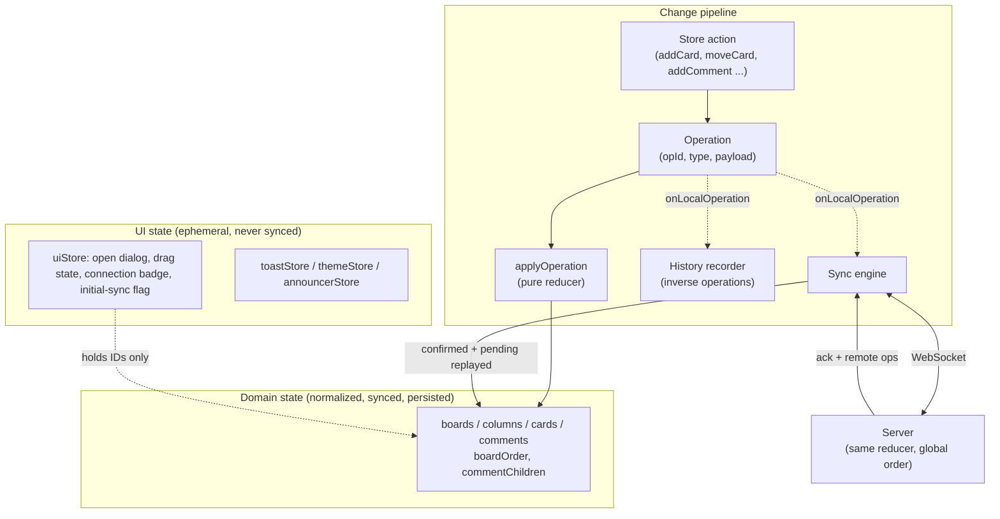
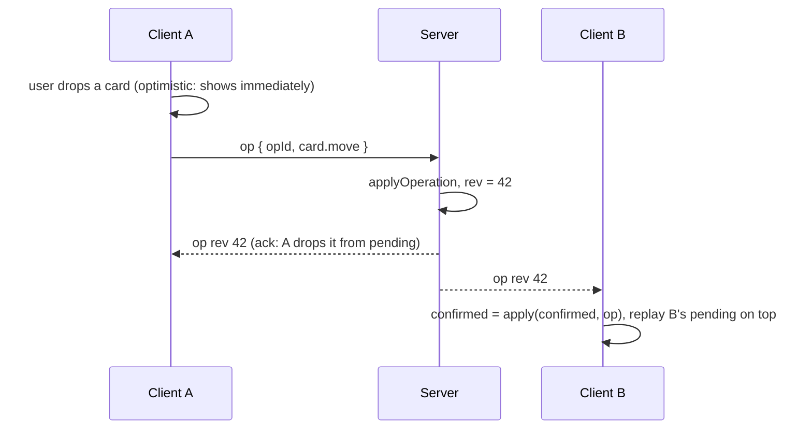

# CollabBoard

A collaborative workspace for managing ideas and execution. Boards hold columns, columns hold cards, and cards carry markdown descriptions, tags, due dates and threaded comments. Several people can work on the same board at once.

**Live demo:** [CollabBoard](https://collab-board-rho-seven.vercel.app/) (open it in two tabs to see real-time sync; each tab is a different anonymous guest)

> **Stage 2** evolves the Stage 1 board system into a collaboration-ready product. Nothing was rebuilt from scratch: the normalized state, the folder layout and the component design carry over. What changed, and why, is documented in [Architecture evolution](#architecture-evolution).

## Contents

1. [What's in Stage 2](#whats-in-stage-2)
2. [Getting started](#getting-started)
3. [Folder structure](#folder-structure)
4. [State architecture](#state-architecture)
5. [Real-time collaboration](#real-time-collaboration)
6. [Drag and drop](#drag-and-drop)
7. [Threaded comments](#threaded-comments)
8. [Undo / redo](#undo--redo)
9. [Performance](#performance)
10. [UX and design system](#ux-and-design-system)
11. [Accessibility](#accessibility)
12. [Testing](#testing)
13. [Tradeoff analysis: custom drag and drop vs a library](#tradeoff-analysis-custom-drag-and-drop-vs-a-library)
14. [Architecture evolution](#architecture-evolution)
15. [Known limitations](#known-limitations)

## What's in Stage 2

| Requirement | Where it lives |
| --- | --- |
| Drag and drop (reorder, move across columns) | `src/features/dnd/`, `src/lib/ordering.ts`, `src/lib/dnd.ts` |
| Real-time simulation (WebSocket) | `server/index.ts`, `src/realtime/` |
| Optimistic UI, conflict handling, reconciliation | `src/realtime/syncEngine.ts`, `src/realtime/operations.ts` |
| Threaded comments (edit, delete, nested replies) | `src/features/comments/`, `commentChildren` in the domain state |
| Undo / redo (command pattern) | `src/history/` |
| Performance stress test | `src/perf/` (the in-app Performance Lab, `?perf`) |
| Skeletons, error boundaries, toasts, empty states, dark mode | `src/components/`, `src/store/ui/`, `src/index.css` |
| Design system (Button, Input, Modal, Badge) | `src/components/ui/` |
| Tests (unit and integration) | `*.test.ts(x)` next to the code they test |

Stage 1 features (dashboard, columns, cards, markdown, tags, due dates) are unchanged. Everything is still React + TypeScript in strict mode, with no UI library, no drag-and-drop library and no template starter.

## Getting started

```bash
pnpm install
pnpm dev             # the web app; works on its own in local-only mode
pnpm server          # the real-time WebSocket server (port 8787)
pnpm dev:server      # same, with restart on file changes
pnpm test            # Vitest, one run (101 tests)
pnpm test:watch
pnpm build           # type-check and production build
pnpm preview         # serve the production build locally
pnpm lint            # ESLint, including jsx-a11y rules
pnpm typecheck:server
```

**To try real-time sync locally**

1. Create `.env.local` containing `VITE_WS_URL=ws://localhost:8787`.
2. Run `pnpm server` in one terminal and `pnpm dev` in another.
3. Open the app in two browser tabs. Each tab gets its own guest identity, so two tabs behave like two users.

If `VITE_WS_URL` is not set, the app runs in **local-only mode**: no connection is attempted, the connection badge is hidden, and data lives in `localStorage` as in Stage 1.

**Deployment:** the web app is a static Vite build on Vercel (`VITE_WS_URL` is set as a Vercel environment variable, using `wss://` because the site is served over HTTPS). The WebSocket server is a small Node process (`server/index.ts`) deployed separately. It exposes `GET /health` for the host's health check and supports an `ALLOWED_ORIGINS` environment variable (comma-separated) to refuse WebSocket connections from unknown pages.

## Folder structure

```
server/
└── index.ts            WebSocket server: authoritative state, ordering, broadcast, heartbeat
src/
├── app/                AppLayout (header, skip link, route-level error boundary), Logo, RouteFallback
├── components/
│   ├── ui/             Design system: Button, IconButton, Input, TextField, Modal, ConfirmDialog,
│   │                   Badge, Skeleton, EmptyState, ToastViewport, ThemeToggle, icons
│   └── *ErrorFallback, ErrorBoundary
├── features/           Everything that knows about boards, cards or comments
│   ├── boards/         BoardList, BoardCard, dialogs, BoardListSkeleton
│   ├── columns/        Column, ColumnHeader, title editor, AddColumnForm, BoardSkeleton
│   ├── cards/          CardItem, CardForm, CardDetailModal, MarkdownView, TagInput ...
│   ├── comments/       CommentSection, CommentItem (recursive), CommentForm, usePagedIds
│   ├── dnd/            pointerDrag, keyboardDrag, DragHandle, DragPreview, DragAnnouncer
│   ├── history/        HistoryControls (Undo / Redo buttons)
│   └── realtime/       ConnectionStatus
├── history/            Command pattern: commands (build entries), historyStore, shortcuts
├── realtime/           operations (the shared reducer), protocol, transport, syncEngine
├── store/
│   ├── domain/         domainStore: normalized entities, actions, persistence
│   ├── ui/             uiStore (drag, modals, connection), toastStore, themeStore, announcerStore
│   └── hooks.ts        One-entity selector hooks
├── lib/                Pure utilities: ordering, dnd, markdown, identity, debouncedStorage ...
├── perf/               Performance Lab (opt-in), seed data generator, render stats
├── pages/              DashboardPage, BoardPage (lazy loaded), NotFoundPage
├── test/               Test setup, fixtures, helpers
└── types/              domain.ts
```

Boundaries that matter:

- `components/ui` knows nothing about boards or cards, so primitives stay reusable.
- `realtime/operations.ts` is **pure TypeScript with no React or browser imports**. The browser, the server, and undo/redo all run the same reducer. This is the most important file in the project.
- `store/domain` and `store/ui` are separate folders so the domain/UI split is enforced by structure, not by convention.
- `server/` imports `src/realtime/operations` and `src/realtime/protocol` directly, so the client and server can never disagree about the rules.

## State architecture



### Normalized domain state

```ts
interface DomainSnapshot {
  boardOrder: ID[]
  boards:   Record<ID, Board>        // Board.columnIds: ID[]
  columns:  Record<ID, Column>       // Column.boardId, Column.cardIds: ID[]
  cards:    Record<ID, Card>         // Card.columnId
  comments: Record<ID, CardComment>  // CardComment.cardId, CardComment.parentId
  commentChildren: Record<ID, ID[]>  // ordered child ids, keyed by card id OR comment id
}
```

- Flat maps keyed by ID. Updating one card, or one comment, replaces `cards[id]` or `comments[id]` and nothing above it.
- Parents own ordering through ID arrays; children point back to their parent by ID.
- **Comment threads are an adjacency list, not a nested tree.** `commentChildren[cardId]` lists a card's top-level comments, and `commentChildren[commentId]` lists a comment's replies. IDs are unique, so the two kinds of key never collide, and a thread of any depth is stored in two flat maps.
- Everything is serializable (ISO strings, no functions), so the same snapshot can be persisted, sent over a socket, or replayed.
- Every reducer case returns the **same state reference** when nothing changes. A duplicate or stale operation is therefore harmless and triggers no re-render.

### Domain state vs UI state

`useDomainStore` holds data that is shared between users. `useUIStore` holds what only this tab cares about: which dialog is open, what is being dragged, whether the socket is connected. UI state stores IDs only, never copies of entities, so there is one source of truth. Local-only form drafts stay in component `useState`.

This split paid for itself in Stage 2. Drag state changes up to 60 times a second and must never be broadcast or persisted. Because it lives in its own store, none of that traffic touches the sync engine.

### Every change is an operation

All mutations go through one path: a store action builds an `Operation`, `applyOperation` computes the next state, and listeners hear about it.

```ts
type Operation = { opId; at; by } & (
  | { type: 'card.create'; card }
  | { type: 'card.update'; cardId; patch }          // only the fields that changed
  | { type: 'card.move';   cardId; toColumnId; afterCardId }
  | { type: 'card.delete'; cardId }
  | { type: 'comment.add' | 'comment.edit' | 'comment.delete'; ... }
  | { type: 'board.create' | 'board.delete' | 'column.add' | 'column.rename' | 'column.delete'; ... }
)
```

One representation serves four jobs: optimistic updates, network messages, conflict resolution, and undo/redo.

### Why Zustand

- **Context + `useReducer`** re-renders every consumer on any change, which fights the performance requirements.
- **Redux Toolkit** would work, but its boilerplate is heavy here, and we do not need its middleware ecosystem because the operation log is our own pipeline.
- **Zustand** gives selector-based subscriptions (a component re-renders only when its slice changes), needs no providers, and exposes `getState()` / `setState()` outside React. That last point is what lets the sync engine, history and drag code run as plain TypeScript modules that are easy to test.

## Real-time collaboration

### Architecture

A small Node WebSocket server (`ws`) holds the **authoritative state in memory**. Clients send operations; the server applies them in the order it receives them, assigns each a global revision number (`rev`), and broadcasts it to everyone, including the sender. The sender's copy is its acknowledgement.

**Connection health.** The server pings every connected client every 30 seconds and terminates any socket that did not answer the previous ping (a closed laptop, a dropped network), so dead connections do not pile up. Browsers answer pings automatically, and clients reconnect with backoff (see Reconnect below).



### Client: prediction with reconciliation

The sync engine (`src/realtime/syncEngine.ts`) keeps three things:

| Name | Meaning |
| --- | --- |
| `confirmed` | The server's state as of the last operation we received, in the server's order |
| `pending` | Our own operations the server has not acknowledged yet |
| on screen | `confirmed` with `pending` replayed on top |

- **Optimistic UI.** A local action is applied to the store immediately and queued in `pending`.
- **Acknowledgement.** When our own operation comes back, we remove it from `pending`. The screen already shows `confirmed + pending`, which is now the new `confirmed`, so **no store write and no re-render** happens.
- **Remote operation.** Apply it to `confirmed`, then replay `pending` on top and write the result to the store. Entities that `pending` does not touch keep their object references, so unrelated components do not re-render.
- **Rejection (`noop`).** If the server says an operation no longer applies (for example, the target card was deleted), we drop it from `pending` and replay. The optimistic change rolls back on its own.
- **Gap detection.** If a message arrives with `rev > ours + 1`, we missed something and ask for a fresh snapshot.
- **Reconnect.** The transport reconnects with exponential backoff (500 ms up to 10 s) and jitter, so many clients do not stampede a restarted server. On reconnect we receive a snapshot, rebuild, and **re-send anything the server never acknowledged**. The server remembers recent `opId`s (last 5,000) and treats duplicates as no-ops, so re-sending is safe.
- **Offline.** Local edits keep working and wait in `pending`. A connection badge shows Live, Connecting or Offline.
- **Noise control.** Remote changes show a toast saying who did what. A burst (someone importing 200 cards) shows the first three toasts and then one summary, instead of burying the screen.

### Conflict handling: what happens if two users edit the same card?

The server is the single source of order. Two operations that arrive "at the same time" are simply applied one after the other, and every client converges on that order. The rules below decide the outcome:

| Situation | Outcome | Why |
| --- | --- | --- |
| Two users edit **different fields** of the same card (A changes the title, B changes the due date) | **Both edits survive.** | `card.update` carries only the fields that actually changed (`diffCardPatch`), so patches merge field by field. |
| Two users edit the **same field** (both change the title) | **The operation the server applies last wins.** The first editor sees a toast that the card was edited by someone else. | Last-writer-wins by *server arrival order*. We deliberately do not compare client timestamps, because client clocks cannot be trusted. |
| One user **edits** a card while another **deletes** it | **Delete wins.** The edit becomes a no-op and the client rolls it back. | Resurrecting a deleted card from a stale edit is more surprising than losing the edit. Deletion is explicit intent. |
| Two users **move the same card** to different places | **The last move applied wins**, and every client ends up with the same position. | Moves are idempotent state transitions, ordered by the server. |
| A user **moves a card** while another **inserts a card above it** | **The move still lands in the right place.** | Moves carry an *anchor* (`afterCardId`, "put me after this card"), not a raw index. A concurrent insert above shifts indexes but not anchors. If the anchor itself is gone, the card goes to the end of the column. |
| A user **creates a card** in a column someone just **deleted** | The create is ignored (no-op). | Cards cannot exist without a column; the creator's optimistic card rolls back. |
| A user **edits** a comment while another **deletes** it | **Delete wins.** | Same reasoning as cards. |
| A user **replies** to a comment that was just **deleted** | **The reply is kept** under the tombstone. | Deleting a comment replaces its body with a tombstone instead of removing it, so replies never become orphans. |
| A user edits or deletes **someone else's** comment | Rejected. | `comment.edit` / `comment.delete` carry the requester's `authorId`, and the reducer checks it. |

**Known weakness:** a card's *description* is conflict-resolved as one whole value. If two people edit the same description at the same moment, one set of changes is lost. Merging text properly needs OT or a CRDT. That is the first thing I would add (see [What I would refactor](#what-i-would-refactor-with-3-more-weeks)).

### Why WebSocket and a shared reducer

Polling with conflict resolution was the allowed alternative. WebSocket was chosen because the brief calls it preferred, and because the design above (a global order plus acknowledgements) is cleaner when the server can push. Sharing `applyOperation` between browser and server means optimistic prediction and server truth cannot drift: they are the same code.

### Persistence ("API abstraction layer")

The UI never talks to the network. The path is:

```
component → store action → Operation → onLocalOperation → sync engine → Transport → server
```

`Transport` (`src/realtime/transport.ts`) is a small interface (`send`, `onMessage`, `onStatus`, `start`, `stop`). The WebSocket implementation is one implementation of it. Swapping in HTTP polling, or an in-memory fake for tests, changes one file and leaves the engine untouched. The server's state is in memory (the "mock data" layer); if it restarts, the first client to reconnect re-seeds it from its local copy. Each browser also caches the domain state in `localStorage` (writes are debounced, see [Performance](#performance)).

## Drag and drop

Built from scratch with Pointer Events and no library. Supported: **reorder within a column**, **move across columns**, **keyboard dragging**, edge auto-scroll, and cancel.

**Pointer drag** (`pointerDrag.ts`)
- A press becomes a drag only after the pointer moves 5 px, so clicks on cards still open the card.
- Pointer tracking is throttled with `requestAnimationFrame`. Each frame resolves the target column with `elementFromPoint` and finds the insert position with **binary search** over the column's cards, so a 200-card column costs about 8 layout reads per frame instead of 200 (`findInsertIndex`, tested).
- A floating `DragPreview` follows the pointer, and a ghost placeholder shows where the card will land.
- The board auto-scrolls sideways and the column auto-scrolls vertically near the edges (`getEdgeScrollDelta`).
- Escape and `pointercancel` abort without changing anything. A drag never also counts as a click on the card beneath it.
- **Event cleanup:** one `finish()` function removes every listener (`pointermove`, `pointerup`, `pointercancel`, `keydown`, `scroll`), cancels the pending animation frame, and resets body styles and the cursor. `BoardPage` calls `cancelPointerDrag()` on unmount, so navigating away mid-drag leaves nothing behind.

**Keyboard drag** (`keyboardDrag.ts`): focus the drag handle, press Space to pick up, arrow keys to move (including between columns), Space to drop, Escape to cancel. A live region announces every step ("Moved to column Doing, position 2 of 5").

**State and ordering**
- Ordering lives on the column (`cardIds`). `moveCardInState` is pure and returns `null` when nothing would change. A reorder inside one column replaces only that column's array; the card objects are untouched.
- The drop becomes **one** `card.move` operation. Keyboard moves are previewed **locally only** (`{ local: true }`), and on drop the card is put back and the move is performed once for real. Other sessions therefore receive a single operation instead of watching the card hop on every key press (covered by a test).
- **Re-render discipline.** While dragging, `Column` subscribes to *primitive* selectors that only return a value for the column being hovered, and `CardItem` subscribes to "am I the dragged card". A drag therefore re-renders the old and new target column, not the whole board. Keys are stable entity IDs, never indexes.

## Threaded comments

- Each card has threaded comments: **add, reply, edit, delete**. The data model allows unlimited depth; the UI offers "Reply" down to depth 4 (`MAX_REPLY_DEPTH`) to keep threads readable. The requirement was two levels; tests cover three.
- **Normalized:** `comments` by ID plus the `commentChildren` adjacency list (see [State architecture](#normalized-domain-state)).
- **Soft delete:** deleting a comment leaves a tombstone, so replies keep their parent and a delete racing a reply cannot orphan anything.
- **Efficient rendering for large trees:**
  - `CommentItem` is recursive and `memo`-wrapped; each one subscribes only to its own comment and its own reply list.
  - Adding a reply re-renders that comment and its ancestors' reply lists, not the whole thread.
  - Long threads are **paged**: the latest 30 top-level comments and the latest 15 replies per comment are shown, with "Show earlier" buttons that announce themselves to screen readers.
  - Deleting a card or column removes its comments with an **iterative stack walk**, not recursion, so a very deep thread cannot overflow the call stack (a test deletes a 20,000-deep thread).
- Comments are real-time: adds, edits and deletes are operations like any other.

## Undo / redo

Implemented as an **action history using the command pattern** (`src/history/`). There is no full-state cloning anywhere.

- When the local user performs an action, `createHistoryEntry(op, before)` builds a `HistoryEntry` containing a label, a list of **forward operations** (to redo) and a list of **inverse operations** (to undo). It reads only what it needs from `before`, the state the operation replaced, so the cost is proportional to the *change*, not the board size.
- Undoable: **card creation, card deletion, card movement** (required) and **card edits** (extra).
- Inverses:
  - create ↔ delete.
  - delete → re-create the card, put it back at its **original position** (using an anchor), and **restore its whole comment thread**.
  - move → move back to the original column and anchor.
  - edit → restore *only the fields that edit touched*, so a teammate's edit to another field is left alone.
- Two stacks (`undoStack`, `redoStack`), capped at 100 entries. A new action clears the redo stack. History is scoped to one board and clears when you leave it.
- Shortcuts: Ctrl/Cmd+Z, Ctrl/Cmd+Shift+Z and Ctrl+Y. They step aside while you type in a field (the browser's text undo wins), while a dialog is open, and during a drag. Undo and Redo buttons sit in the board header, and deleting a card shows a toast with an **Undo** action.
- **Undo is just more operations.** Undoing dispatches inverse operations through the normal pipeline, so it **replicates to other users** and is reconciled like any other change. `withoutHistory` stops undo from recording itself.
- **Multi-user honesty:** undo reverses *your* change only. If someone else already changed the thing (for example, deleted the card you are trying to restore), the inverse is a no-op. The entry is dropped and an error toast says "Couldn't undo ... Someone else may have changed it." It never silently corrupts the board.
- Not yet undoable: board and column operations, and comments (see [Known limitations](#known-limitations)).

## Performance

### Strategy

- **Code splitting.** `BoardPage` is a lazy-loaded route. In the latest production build it is its own chunk (111 kB, about 36 kB gzipped, including the markdown libraries); the main bundle is about 300 kB (about 95 kB gzipped); the Performance Lab is a separate 6 kB chunk loaded only with `?perf`.
- **IDs down, not objects.** Lists select ID arrays, and every item (`Column`, `CardItem`, `CommentItem`, `BoardCard`) subscribes to its *own* entity through one-entity hooks. Props are primitives, so `memo` actually works.
- **Narrow selectors.** Drag and rename state use boolean or primitive selectors, so changes re-render only the components affected.
- **Structural sharing.** The reducer returns the same reference for unchanged entities and for no-op operations. Zustand skips notifications in both cases.
- **Optimistic acknowledgements are free.** An acknowledged operation updates bookkeeping only (no store write, no render), so the user's own edits are not rendered twice.
- **Batched undo/redo.** `applyOperations` applies several operations in memory and writes to the store **once**, so multi-operation undo (for example, restoring a card and 120 comments) is one render.
- **Debounced persistence.** Zustand's default `persist` serializes the whole state to JSON on every change. `createDebouncedJSONStorage` writes once after changes stop (300 ms) and flushes when the tab is hidden or closed, so a drag-heavy session does not stringify hundreds of cards repeatedly.
- **Cheap drag math.** Binary search over card midpoints and `requestAnimationFrame` throttling (see [Drag and drop](#drag-and-drop)).
- **Comment paging** instead of rendering thousands of nodes.
- **Layout containment of cost.** The page never scrolls: the board scrolls sideways and each column scrolls its own list, so a long column does not lay out the whole page.
- **`memo` is deliberate.** `memo` wraps list items. `useMemo` is used where work is genuinely expensive (markdown parse and sanitize, which reruns only when the text changes). `useCallback` is not sprinkled around where it buys nothing.

### List virtualization: a deliberate decision

The brief says to "consider list virtualization". I considered it and **did not implement it**, for these reasons:

1. **The target load is not list-shaped.** The stress target is 200+ cards across 20+ columns, about 10 cards per column. Each column's list is short; the cost is in *how many items re-render on a change*, and that is solved by per-entity subscriptions, not by windowing.
2. **Virtualization fights custom drag and drop.** Pointer drag measures real DOM positions (binary search over `getBoundingClientRect`), keyboard drag moves focus between real elements, and screen readers and find-in-page expect the items to exist. Windowing would need a measurement cache and placeholder heights that stay correct during a drag. That is a large amount of risk for a load that does not need it.
3. **Where windowing *would* matter** is one column holding many hundreds of cards, or hundreds of columns. The Performance Lab can seed up to 60 columns and 500 cards per column to find that point; if column size becomes the bottleneck, windowing individual columns above a card-count threshold is the planned next step.

For comment threads, where the list really can be long, I used **paging**, which keeps the DOM small without breaking accessibility.

### Performance Lab (stress test and profiling)

Add `?perf` to a board URL (for example `/boards/<id>?perf`) to open an in-app lab. It is code-split and costs normal users nothing.

- **Seed:** generate N columns × M cards, plus "hot" cards with deep comment threads (default **24 columns × 10 cards = 240 cards, 3 threads × 120 comments**), as a single batched operation.
- **Move benchmark:** performs N random card moves and reports main-thread cost per move (render + commit + layout) as median / p95 / worst, plus time to next frame.
- **Comment benchmark:** adds N comments to one card and reports dispatch time.
- **React commit counts** (via `<Profiler>` around the board) are reported in the dev build. A copy-report button includes the environment.
- **Cleanup** removes everything the seed created.

**How to reproduce:** `pnpm dev`, open a board with `?perf`, click Seed, then Benchmark moves, and read the report. For production timings, run `pnpm build && pnpm preview` (commit counts need the dev build). To confirm the render story in **React DevTools**: record in the Profiler, drag a card between columns, and note that only the source and target `Column` and the dragged `CardItem` render; the other columns show "did not render".

**Results** (development build, Chrome 156 on Windows 10, with the React Profiler active, which makes it slower than production):

| Scenario | Result |
| --- | --- |
| Seed 24 columns × 10 cards (240 cards) + 360 comments, 624 operations: applied / painted | 29.3 ms applied; 384.9 ms until painted, in 1 React commit (194.8 ms in React) |
| 50 random card moves: main-thread cost (render + layout) | median 6.9 ms, p95 9.0 ms, worst 10.2 ms |
| 50 random card moves: time to next frame | median 24.8 ms |
| 50 random card moves: React commits | 51 in total, 1.0 per move (135.5 ms in React in total) |
| 50 comments added to one card: dispatch time | 27.2 ms in total, 0.5 ms each |
| 50 comments added to one card: React commits | 0 (0.0 ms in React) |

**Reading the numbers**

- **Moves.** Each move costs one render pass (1.0 commits per move). The worst of 50 random moves across 240 cards took 10.2 ms of main-thread work, inside a 16.7 ms frame at 60 Hz. The 24.8 ms "time to next frame" also includes the benchmark waiting for the next animation frame and dev-mode overhead, so it overstates the real cost.
- **Seeding.** The whole 624-operation seed is applied as one batch in about 29 ms. The 385 ms until paint is mostly React mounting 240 cards for the first time, in a single commit.
- **Comments.** Zero commits is intended: card tiles do not subscribe to comments, so adding comments to a card whose dialog is closed re-renders nothing. The cost is only the store update (0.5 ms per comment).
- These are development-build figures from a single machine, so treat them as a baseline for spotting regressions, not as production guarantees.

## UX and design system

- **Design tokens.** Color, radius and shadow live in Tailwind's `@theme` (`src/index.css`). **Dark mode** is a second set of the same token values under `[data-theme='dark']`; no component contains a color conditional. A small inline script in `index.html` sets `data-theme` *before first paint* (saved choice, else `prefers-color-scheme`), so there is no flash of the wrong theme. `ThemeToggle` flips it and saves the choice.
- **Reusable components** (`src/components/ui`): `Button`, `IconButton` (requires an accessible `label` in its type), `Input` / `TextField`, `Modal` and `ConfirmDialog`, `Badge`, `Skeleton`, `EmptyState`, `ToastViewport`. They know nothing about boards or cards.
- **Loading skeletons** for the dashboard and the board, shown while the first sync is pending (with an 8 s timeout, so a sleeping free-tier server cannot trap the user on a skeleton).
- **Error boundaries** at two levels: the whole app, and the routed page (with `resetKey`, so navigating away recovers). Because the route boundary wraps the `Suspense` for lazy pages, a lazy chunk that fails to load is caught too.
- **Toasts** for confirmations and for remote changes, with action buttons (Undo, Redo). At most four show at once; errors use `role="alert"`, the rest sit in a polite live region.
- **Empty states** for no boards, no columns and no cards, each with guidance on what to do next.
- **Connection badge** shows Live, Connecting or Offline (and is hidden in local-only mode).

## Accessibility

Stage 1 accessibility is kept, and Stage 2 features were built to the same bar.

- Semantic landmarks and headings, real lists, `<time dateTime>`, native buttons, and a skip link as the first tab stop.
- **Dialogs:** `role="dialog"` (`alertdialog` for destructive confirmations), `aria-modal`, labelled and described, with a hand-built focus trap, Escape closing only the topmost dialog, and focus returning to the trigger. Confirmation dialogs start on Cancel.
- **Drag and drop is fully keyboard-operable** (Space / arrows / Escape) with screen-reader announcements for pick up, each move, drop, cancel, and "can't move further". The drag handle has a descriptive label.
- **Comments:** reply, edit and delete forms move focus in and return it to the triggering button; "Show earlier" announces how many comments appeared.
- **Live regions** for toasts, connection status, creations and deletions. After deleting something, focus moves to a stable heading because the trigger is gone.
- Global `:focus-visible` ring, `motion-safe` animations, and `eslint-plugin-jsx-a11y` in the lint config. Dark mode uses its own focus and badge colors to keep contrast.

## Testing

`pnpm test` runs Vitest with Testing Library and jsdom. Latest run: **10 test files, 101 tests, all passing.**

| Area | File | Tests | What it proves |
| --- | --- | --- | --- |
| **Drag logic** | `src/lib/ordering.test.ts` | 14 | Pure move: reorder, cross-column, empty column, clamping, no-op returns `null`, input is not mutated, keyboard targets and edges |
| | `src/lib/dnd.test.ts` | 11 | Insert-index math, binary search measures only a handful of cards, edge auto-scroll speeds |
| **Undo / redo** | `src/history/commands.test.ts` | 10 | Each inverse restores the *exact* earlier state (including mid-column delete with its comments); a teammate's edit to another field is preserved |
| | `src/history/historyStore.test.ts` | 9 | Stack behavior, redo cleared by new action, 100-entry cap, honest failure when someone else changed things, Undo toast only for the latest action |
| **Comments** | `src/realtime/comments.test.ts` | 14 | Nesting, validation, author-only edit/delete, tombstones, delete-vs-edit and delete-vs-reply, 20,000-deep thread cascade |
| | `src/store/domain/comments.test.ts` | 7 | Store actions: trimming, three-level threads, rejection without notifying other sessions |
| **Conflict resolution** | `src/realtime/operations.test.ts` | 23 | Field-level merge, same-field last-wins, delete-wins, anchored moves surviving concurrent inserts, idempotency, cascades |
| **Persistence** | `src/lib/debouncedStorage.test.ts` | 6 | One write after changes stop, flush on hide, read-your-pending-write |
| **Integration** | `src/pages/BoardPage.test.tsx` | 5 | Renders the real board page against the real store; keyboard pick-up, cross-column move and drop; Escape cancels; **other sessions receive exactly one operation on drop**; edge-of-board message |
| | `src/features/comments/CommentThread.test.tsx` | 2 | Through the card dialog: add, reply, edit and delete a comment; a large thread shows the latest 30 and reveals earlier ones on request |

Design choices that made this testable: the reducer, ordering, drag math and history builders are **pure functions**, so most tests need no DOM and run in milliseconds; the stores can be driven through `getState()`.

**Not covered (by design or time):** the sync engine and WebSocket transport are exercised manually across two tabs rather than by automated tests; the server has no tests; pointer-drag geometry is not testable in jsdom (no layout), so the geometry math is extracted and unit-tested instead. These are listed under technical debt.

## Tradeoff analysis: custom drag and drop vs a library

Stage 1 banned drag-and-drop libraries; Stage 2 does not require either choice. I stayed with a custom implementation. The honest tradeoffs:

| | Custom (chosen) | Library (e.g. dnd-kit, react-beautiful-dnd successors) |
| --- | --- | --- |
| **Bundle cost** | No dependency; roughly 20 kB of source (comments included) that ships inside the lazy-loaded board chunk | Adds a dependency, typically tens of kB for a full-featured one |
| **Integration with our model** | Drop becomes *one* anchored `card.move` operation; keyboard moves previewed locally and sent once; drag state in its own store | Usually need an adapter between the library's model and our operations, and to prevent its internal state from fighting ours |
| **Real-time fit** | Full control over what is broadcast and when | Possible, but previews tend to mutate app state, which is the exact thing we must not broadcast |
| **Re-render control** | Primitive selectors per column and card; known and measured | Depends on the library's internals and context usage |
| **Accessibility** | Built to our own announcement and focus rules | Good libraries ship strong a11y; we would still verify it |
| **Edge cases** | We own every one: touch, scroll containers, auto-scroll, cancel, unmount mid-drag | A mature library has already met most of them (multi-touch, nested scrollers, RTL, sensors) |
| **Maintenance** | We maintain it | Upstream maintains it (and may stop; several popular ones have) |
| **Virtualization** | Hard to combine (see [Performance](#list-virtualization-a-deliberate-decision)) | Some have first-class support |
| **Time to first working version** | Slower | Faster |

**Decision:** custom, because the requirements that matter most here (one operation per drop, no broadcast of previews, minimal re-renders, keyboard parity) are all about *controlling* what drag does to state, and that is easiest when drag is part of our own pipeline. **What I would reconsider:** if the product needed touch-first mobile drag, nested sortable lists, or virtualized columns, I would adopt a library and write a thin adapter that converts its drop event into our `card.move` operation. The `dropCard()` seam (`src/features/dnd/persistMove.ts`) is where that adapter would plug in.

## Architecture evolution

### What broke when adding real-time

1. **Mutating actions assumed a single writer.** In Stage 1 each store action edited state directly. With two writers, "apply my change and move on" has no answer to "what if the server disagrees?". **Fix:** every change became an `Operation` run through a pure reducer, so the same change can be applied optimistically, sent, acknowledged, replayed or rolled back.
2. **Index-based moves were wrong under concurrency.** "Move to index 3" means something different after a teammate inserts a card above. **Fix:** moves carry an *anchor* (`afterCardId`) and the index is derived when applied. Undo uses the same anchors.
3. **Whole-object updates lost edits.** Saving the whole card overwrote a teammate's edit to a different field. **Fix:** `card.update` sends only the fields that changed and the reducer merges per field.
4. **Deletes left dangling references.** A comment, card, or edit could arrive for something already deleted. **Fix:** every reducer case validates that its targets exist and is a no-op otherwise, deletes win over edits, comment deletes leave tombstones, and cascades are explicit and iterative.
5. **Optimistic updates rendered twice.** Naively, "apply local, then apply the server's echo" re-renders for the user's own edit. **Fix:** separate `confirmed` and `pending`; acknowledging an operation touches only bookkeeping.
6. **Drag previews were dangerous.** Letting a keyboard preview broadcast would flood other users with intermediate positions. **Fix:** a `local: true` flag for previews and a single operation on drop, with drag state kept in the UI store.
7. **Persisting on every change got expensive.** With drag and bulk updates, the default `localStorage` persistence stringified the whole state constantly. **Fix:** debounced storage that flushes on tab hide.
8. **Initial load raced the first sync.** A shared board link opened before the snapshot arrived showed "Board not found". **Fix:** an `initialSync` flag shows skeletons until the first snapshot (or an 8 s timeout).
9. **Out-of-order and duplicate delivery.** Reconnects re-send unacknowledged operations. **Fix:** operation IDs, server-side duplicate memory, revision numbers and gap detection with a resync.
10. **Dead connections hid behind reconnects.** Without a heartbeat, a client that vanished (closed laptop, dropped network) kept its socket open on the server. **Fix:** the server pings every 30 s and terminates any socket that did not answer the previous ping. The reconnect logic then brings healthy clients straight back with a fresh snapshot and their unacknowledged operations.

### What changed in the state structure

| Stage 1 | Stage 2 | Reason |
| --- | --- | --- |
| `boards`, `columns`, `cards` maps | Same, unchanged | The normalized shape held up: nothing had to be re-shaped to add multiple writers |
| (none) | `comments` map + `commentChildren` adjacency list | Threads of any depth in two flat maps; per-comment subscriptions |
| Actions mutate state | Actions build an `Operation`; one pure `applyOperation` | One representation for optimistic UI, network, conflict resolution and undo |
| Index-based ordering on moves | Anchor-based (`afterCardId`) over the same `cardIds` arrays | Concurrency-safe moves |
| One store | Domain store, UI store, and separate history, toast, theme, announcer stores | Drag traffic, history and notifications must not touch synced data |
| Whole-object card save | Field-level patches | Merge instead of overwrite |
| Direct `localStorage` persistence | Debounced persistence + server as source of truth | Cost and correctness |
| (none) | `confirmed` / `pending` view in the sync engine | Prediction with reconciliation |

The Stage 1 claim that normalized state "scales to real-time updates" was tested here, and held: every entity is addressed by ID, so a remote change is one keyed update and fits straight into the existing selectors.

### Technical debt (honest list)

- **No authentication.** Identity is an anonymous per-tab guest ID. Author checks on comments are enforced in the reducer, but the server trusts the `authorId` the client sends, so a hostile client could impersonate someone. Real auth would make the server derive identity from a session.
- **The server is in memory and single-process.** A restart loses state (the next client re-seeds it from its local copy). There is no database and no horizontal scaling.
- **One global workspace.** The server holds one state; every client receives a full snapshot on connect and every operation, including those for boards it is not viewing.
- **Description edits are last-writer-wins on the whole string.** Concurrent edits to the same description lose one side.
- **The reducer copies whole maps per operation** (`{ ...state.cards, [id]: card }`). That is fine at hundreds of entities and becomes a cost at tens of thousands. An immutable structure with structural sharing (or Immer) would fix it.
- **`showOptimistic()` replays all pending operations** on every remote operation. That is negligible with a handful of pending operations but linear in the offline queue length.
- **The pending queue is memory-only.** Closing the tab while offline loses unsent operations (the local cache holds the *result*, not the queue).
- **Undo gaps:** board, column and comment operations are not undoable, and history does not survive a reload.
- **No windowing** for very long columns (see [Performance](#list-virtualization-a-deliberate-decision)).
- **Test gaps:** no automated tests for the sync engine, the transport, or the server; no end-to-end test with two real sessions.
- **Validation is shallow at the protocol boundary.** The server checks message shape and wraps the reducer in `try/catch`, but does not validate every field of every operation. There is no rate limiting.
- **Perf results are hand-run**, not tracked in CI, so regressions would not be caught automatically.

### What I would refactor with 3 more weeks

**Week 1: make the server real.**
- Persist an **append-only operation log** (Postgres or similar) plus periodic snapshots, so state survives restarts, and a late client can ask for "operations since revision N" instead of a full snapshot (the revision numbers already support this).
- Add authentication; derive `authorId` from the session on the server; add per-connection rate limiting and full schema validation of operations.
- Write the missing tests: a **fake `Transport`** that lets the sync engine be tested deterministically (reordering, duplicates, dropped acks, reconnects), and a server test with two sockets.

**Week 2: collaboration quality.**
- **Collaborative text** for card descriptions (a CRDT such as Yjs, or OT) so same-field edits merge instead of overwrite.
- **Presence**: who is on the board, who is editing which card, and live cursors for drags (broadcast on a throttled, *ephemeral* channel that is never part of the operation log).
- Make **undo cover comments, columns and boards**, and keep history across reloads by persisting it.
- Persist the **pending queue** so offline work survives closing the tab.

**Week 3: scale and polish.**
- **Windowing** for large columns, with a measurement cache that stays correct during drags; consider virtualizing columns horizontally for very wide boards.
- Replace whole-map copying in the reducer with a structural-sharing approach.
- Add Playwright tests with two browser contexts, and a **CI performance budget** that runs the Lab's benchmarks and fails on regression.
- Move from fixed-anchor ordering to **fractional indexing**, which makes moves independent of neighbors entirely and removes the "anchor deleted, go to the end" fallback.

### How this scales to 10,000 users

The shared reducer and operation log mean the *correctness* model does not change with scale. What has to change is everything around it, because today's server is one process holding one workspace and broadcasting to everyone.

1. **Shard by board, not by workspace.** Make the board the unit of collaboration: one "room" per board with its own revision counter and operation log. A client subscribes only to the board it is viewing, and the dashboard reads a separate lightweight board list. This turns "every operation to every user" into "every operation to the handful of people on that board".
2. **Stateless gateways, stateful rooms.** Run many WebSocket gateway nodes behind a load balancer; route each board to a single owner process (consistent hashing on board ID) so there is still exactly one serializer of operations per board. Use a pub/sub layer (Redis or NATS) to fan out between gateways and the owner.
3. **Durability.** Store the operation log and snapshots in a database; rooms rebuild from "latest snapshot + operations since". Compact old logs into snapshots. Because `applyOperation` is pure and deterministic, replay is trustworthy.
4. **Cheaper connects.** Clients send their last known `rev`; the server answers with only the missing operations (or a snapshot if too far behind), instead of a full snapshot every time.
5. **Back-pressure and batching.** Coalesce bursts (the client already summarizes toasts; the server would batch broadcasts per tick), cap message sizes (already 1 MB), and rate-limit per connection.
6. **Separate ephemeral from durable traffic.** Presence and drag cursors go over a lossy, unlogged channel; only real changes enter the log.
7. **Client scalability.** Windowed columns, structural-sharing reducer, and paged or lazily loaded comment threads fetched on demand rather than shipped in the board snapshot.
8. **Operations and reliability.** Health checks and a connection heartbeat (already present), graceful draining on deploy so rooms hand off cleanly, metrics on room size, operation rate, p95 ack latency and reconnect rate, and load tests that replay recorded operation streams.

The honest limit: with the current server, a few dozen concurrent users on one workspace is the realistic ceiling, because of the single in-memory process and global broadcast. The path above is how I would get from there to 10,000.

## Known limitations

- Real-time state is held in server memory; restarting the server resets it (the first reconnecting client re-seeds it).
- A free-tier host may take several seconds to wake up; the app shows skeletons, then falls back to local data after 8 s and resyncs when the server answers.
- Identity is an anonymous guest per tab, not real authentication.
- Concurrent edits to the same card description overwrite each other (see [conflict handling](#conflict-handling-what-happens-if-two-users-edit-the-same-card)).
- Undo / redo covers cards (create, delete, move, edit) only.
- No list virtualization (see [Performance](#list-virtualization-a-deliberate-decision)).
- Pointer drag is mouse and pen oriented; touch dragging has not been tuned for mobile.