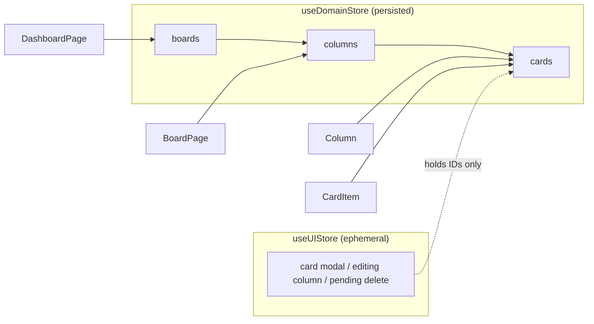

# CollabBoard

A collaborative workspace for managing ideas and execution. Create boards, organize work in columns, and track cards with markdown descriptions, tags, and due dates.

**Live demo:** [CollabBoard](https://collab-board-rho-seven.vercel.app/)

## Features

- **Dashboard:** list boards (title, description, created date), create a board, delete a board with confirmation.
- **Board view:** create, rename (inline), and delete columns.
- **Cards:** create, edit, and delete cards with a title, a markdown description (rendered and sanitized), multiple tags, and a due date.
- Data persists in the browser (`localStorage`).

## Tech stack

React, Vite, TypeScript, Tailwind CSS v4, Zustand, React Router, `marked` + `DOMPurify`. No UI component library, no template starter, no drag-and-drop library.

## Getting started

```bash
pnpm install
pnpm dev      # start the dev server
pnpm build    # type-check and build
pnpm lint     # ESLint, including jsx-a11y rules
```

## Folder structure

```
src/
├── app/            AppLayout (header, skip link, route focus), Logo, RouteFallback
├── components/ui/  Button, IconButton, TextField/TextArea, Modal, ConfirmDialog, icons
├── features/
│   ├── boards/     BoardList, BoardCard, CreateBoardDialog, DeleteBoardDialog
│   ├── columns/    Column, ColumnHeader, ColumnTitleEditor, AddColumnForm, DeleteColumnDialog
│   └── cards/      CardItem, AddCardButton, CardForm, CardDetailModal, CreateCardModal,
│                   CardModalHost, DeleteCardDialog, MarkdownView, TagInput, TagList
├── hooks/          useFocusTrap
├── lib/            cn, date, id, markdown, records, tags (pure utilities)
├── pages/          DashboardPage, BoardPage (lazy loaded), NotFoundPage
├── store/
│   ├── domain/     domainStore: normalized entities and actions (persisted)
│   ├── ui/         uiStore: ephemeral UI state
│   └── hooks.ts    entity selector hooks
├── types/          domain.ts
├── App.tsx         route table only
├── index.css       Tailwind v4 and design tokens
└── main.tsx
```

- `components/ui` knows nothing about boards or cards, so primitives stay reusable and feature folders stay small.
- `features/*` own their domain UI. Pages only compose features and hold no domain logic.
- `store/domain` and `store/ui` are separate folders so the domain/UI split is enforced by structure.

## State architecture



### Normalized domain state

```ts
interface DomainState {
  boardOrder: ID[]
  boards: Record<ID, Board>   // Board.columnIds: ID[]
  columns: Record<ID, Column> // Column.boardId, Column.cardIds: ID[]
  cards: Record<ID, Card>     // Card.columnId
}
```

- Flat maps keyed by ID, with no nesting. Updating a card touches `cards[id]` only; nothing above it is rebuilt.
- Parents own ordering through ID arrays, and children point back to their parent by ID.
- State is serializable only (ISO strings, no functions).
- Cascade deletes (board, column) run inside one `set()`, so there are no orphans and no intermediate renders.
- Because every entity is addressed by ID, a change to one entity is a single keyed update. This is what makes the shape scale to the real-time updates the brief mentions.

### Domain vs UI state

`useDomainStore` holds the data. `useUIStore` holds which card dialog is open, which column is being renamed, and what is awaiting delete confirmation. It stores IDs only, never copies of entities, so there is one source of truth. Form drafts and one-page flags (such as the create-board dialog) stay in local `useState`, because only one component cares.

### Why Zustand

- **Context + `useReducer`** re-renders every consumer on any change, which works against the performance requirements unless contexts are split heavily.
- **Redux Toolkit** would work (`createEntityAdapter` normalizes), but its boilerplate is heavy for this scope.
- **Zustand** gives selector-based subscriptions, so a component re-renders only when the slice it selected changes, with no providers and no prop drilling.

## Performance strategy

- **Code splitting:** `BoardPage` is loaded with `React.lazy` behind a `Suspense` boundary inside the layout. At the time of writing it builds to its own chunk of about 89 kB (30 kB gzipped), which carries the markdown libraries. The dashboard never downloads them.
- **IDs down, not objects.** Lists select only ID arrays, and each child subscribes to its own entity (`BoardCard`, `Column`, `ColumnHeader`, `CardItem`). Memoized components receive primitive props, so `memo` actually works.
- **Narrow selectors.** Rename state uses a boolean selector (`s.editingColumnId === id`), so entering edit mode re-renders only that column's header.
- **Strategic memoization.** `memo` wraps list items. `useMemo` is used where work is genuinely expensive: parsing and sanitizing markdown, which reruns only when the description text changes. `useCallback` is deliberately not sprinkled around, because handlers are passed to native elements or non-memoized components, where stable identity buys nothing.
- **No-op updates keep the same state reference**, so Zustand does not notify subscribers.
- Dialogs are mounted only while open. `Intl.DateTimeFormat` is created once at module level. `useFocusTrap` keeps its callback in a ref so the effect does not re-run and steal focus.

**To see it in React DevTools:** open the Profiler, record, then create a board, rename a column, or edit a card. Only the affected component renders; siblings show as "did not render".

## Accessibility

- **Semantics:** landmarks (`header`, `main`), one `h1` per page, `h2` for boards and columns, real lists, `<time dateTime>`, and native buttons and links.
- **Skip link** as the first tab stop, and focus moves to the main content after in-app navigation.
- **Dialogs:** `role="dialog"` (`alertdialog` for destructive confirmations), `aria-modal`, `aria-labelledby`/`aria-describedby`, rendered in a portal, with page scroll locked while open.
- **Keyboard and focus:** a hand-built focus trap (Tab and Shift+Tab cycle, Escape closes only the topmost dialog, and focus returns to the element that opened it). Confirmation dialogs start on Cancel.
- **Forms:** labels tied with `htmlFor`, `aria-invalid`, `aria-describedby`, `role="alert"` errors, and focus moved to the first invalid field.
- **Icon buttons** require a `label` prop in their type, so an unnamed icon button will not compile. Labels include context ("Delete board Roadmap").
- **Live regions** announce creations and deletions, and tag changes. After a delete, focus moves to the page heading because the trigger is gone.
- Global `:focus-visible` ring, `motion-safe` animations, and `eslint-plugin-jsx-a11y` in the lint config.

## Key engineering decisions

- **Hand-built modal and focus trap** instead of a headless library, because focus management is a graded requirement and this keeps behavior fully understood and tested.
- **One markdown choke point:** `lib/markdown.ts` parses with `marked` and sanitizes with `DOMPurify`. The only `dangerouslySetInnerHTML` in the app receives its output.
- **Due dates are stored as `YYYY-MM-DD` strings** and formatted from their parts, which avoids the timezone off-by-one that `new Date('2026-10-20')` causes.
- **Tags are a `string[]` on the card.** At this scope tags have no identity or attributes of their own, so a normalized tag table would be extra structure with no benefit.
- **Ordering lives on the parent** (`columnIds`, `cardIds`) so reordering is a single array operation.
- **`localStorage` persistence** through Zustand's `persist` with `partialize`, so only data is saved and never actions or UI state. It is a usability convenience, not a requirement.
- **Design tokens in Tailwind's `@theme`** give one source for color, radius, and shadow.

## Known limitations

- Cards cannot yet be moved between columns or reordered, since drag-and-drop libraries were out of scope for this stage.
- Data lives in the browser only, with no backend.
- Light theme only.
