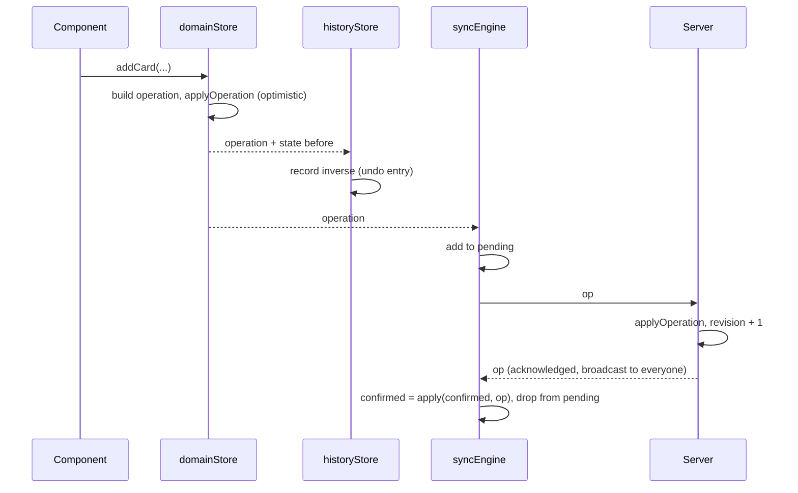
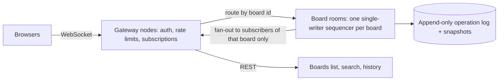

# Architecture evolution: from a local board to a collaborative product

Stage 1 delivered a fast, accessible, single-user board. Stage 2 asked the same codebase to support drag and drop, real-time collaboration, threaded comments, undo/redo and a stress test, without a rewrite. This document explains what held, what broke, what changed, what is still weak, and where it goes next.

**Contents**

1. [Where Stage 1 left us](#where-stage-1-left-us)
2. [What broke when adding real-time](#what-broke-when-adding-real-time)
3. [What changed in the state structure](#what-changed-in-the-state-structure)
4. [How a change flows through the system now](#how-a-change-flows-through-the-system-now)
5. [Undo and redo: the design choice](#undo-and-redo-the-design-choice)
6. [Technical debt](#technical-debt)
7. [What I would refactor with three more weeks](#what-i-would-refactor-with-three-more-weeks)
8. [How this scales to 10,000 users](#how-this-scales-to-10000-users)
9. [What I would do the same again](#what-i-would-do-the-same-again)

---

## Where Stage 1 left us

The Stage 1 decisions that paid off, and still stand:

- **Normalized entities by ID** (`boards`, `columns`, `cards`), with parents owning ordering through ID arrays (`Board.columnIds`, `Column.cardIds`). Updating one card touches one key.
- **Domain state separated from UI state** (`domainStore` vs `uiStore`). The UI store holds IDs only.
- **Selector-per-entity components** wrapped in `memo`, so a change re-renders only what reads it.
- **Zustand**, usable outside React, which turned out to matter for the sync engine, the drag controller and the tests.

What Stage 1 did not have, and that mattered later: every store action mutated state directly and generated its own IDs and timestamps inside the action. That was fine for one user and wrong for many.

## What broke when adding real-time

"What broke" is the honest core of this stage. Each row is something that worked in a single-user world and failed once changes had to travel between sessions, with how it was found and fixed.

| # | What broke | Why | What I did |
|---|---|---|---|
| 1 | **Moving a card by index.** "Put card X at index 2" means something different once someone else inserts a card above index 2. Two concurrent moves landed in the wrong place. | An index describes a position in a list *as one user saw it*. | A move now names the card it should sit **after** (`afterCardId`), resolved against the receiver's list. The store API still takes an index, which is converted to an anchor at dispatch time and back at apply time, so the drag code did not change. If the anchor is gone, the card goes to the end. A test reproduces the concurrent-insert case. |
| 2 | **Actions that mutate state cannot be sent anywhere.** Nothing described *what* changed in a form another machine could replay. | Stage 1 actions were closures over the store. | Every action now builds a serializable **operation** and applies it through one pure function, `applyOperation(state, op)`. The server runs the same function. |
| 3 | **Replicas diverged.** IDs, timestamps and "now" were created *inside* the code that applies a change, so each machine produced different data for the same action. | Non-deterministic reducers. | The operation carries its own `opId`, `at` timestamp and author. The reducer is a pure function of `(state, op)`. `createOperation` lives in its own file because it touches `sessionStorage` and the server must not import that. |
| 4 | **Concurrent edits to one card overwrote each other.** The edit form sent all four fields, so saving tags also re-sent a stale title. | Whole-object writes lose other people's work. | `card.update` carries only the fields that changed. The edit dialog remembers what the card looked like when editing began and diffs against that (not against the live card), so a teammate's edit to another field survives. Found while testing two tabs editing one card. |
| 5 | **Editing a card someone else deleted.** The open dialog vanished silently and focus fell to the page body. | No rule for edit-versus-delete. | Delete wins (documented). The dialog now closes itself, focus moves to the board heading, and a toast says who deleted what. |
| 6 | **Optimistic updates echoed back.** A change applied locally returned from the server and applied twice, or caused a second render. | Own operations come back as acknowledgements. | The client tracks `confirmed` (server order) and `pending` (own, unacknowledged) separately. An acknowledgement of an own operation only updates bookkeeping: no store write, no render. A remote change is applied to `confirmed` and `pending` is replayed on top. |
| 7 | **Keyboard drag spammed other users.** Each arrow press was a move, so teammates watched the card hop cell by cell. | Previews and commits were the same action. | Keyboard moves are **local previews** (`moveCard(..., { local: true })`). Only the drop sends one operation. An integration test asserts "previewing sends nothing, dropping sends exactly one". |
| 8 | **Deleting a card must delete its comment thread**, possibly thousands deep. | Cascades were written for three levels. | The cascade walks the thread with an explicit stack, not recursion. A test deletes a 20,000-deep thread. |
| 9 | **Delete versus reply race.** Someone replies to a comment while its author deletes it. | A hard delete leaves the reply orphaned. | Deleting a comment leaves a **tombstone** (`deleted: true`, empty body). Replies keep their parent. Undoing a card deletion can restore tombstones, so comment validation accepts them. |
| 10 | **Persistence became the slowest thing in the app.** Zustand's `persist` serializes the whole state on every change; seeding 600 operations meant 600 full serializations. | Fine at Stage 1 size, quadratic at scale. | A custom storage keeps the latest state in memory and writes once, 300 ms after changes stop and when the tab is hidden. |
| 11 | **Replaying many operations rendered many times.** Undoing a card deletion (card, move, comments) was N store writes. | One `set()` per operation. | `applyOperations` applies a batch in memory and writes the store **once**, while still notifying listeners per operation so sync and history are unaffected. |
| 12 | **A burst of remote changes buried the screen in toasts.** | One toast per operation. | The first three show, then one summary ("N more changes were made by others"). |
| 13 | **"Board not found" flashed on a shared link** before the first sync arrived. | No notion of "still loading". | `initialSync` state in the UI store, skeletons while it is pending, and an 8 second timeout so a sleeping host cannot block the app. |
| 14 | **Hit-testing the drop target was linear.** A 200-card column cost 200 layout reads per frame. | Naive loop. | Binary search over the (ordered) cards: about 8 reads. |

Two lessons run through the table. First, **identity and ordering must be explicit in the data** (anchors, IDs, timestamps), never implied by position or by "whoever runs the code". Second, **separate "what the user is previewing" from "what has been committed"**, because everything downstream (sync, undo, toasts) should only ever see commits.

## What changed in the state structure

### Before (Stage 1)

```ts
interface DomainState {
  boardOrder: ID[]
  boards: Record<ID, Board>    // columnIds: ID[]
  columns: Record<ID, Column>  // cardIds: ID[]
  cards: Record<ID, Card>      // columnId
}
```

Actions edited this directly.

### After (Stage 2)

```ts
interface DomainSnapshot {
  boardOrder: ID[]
  boards: Record<ID, Board>
  columns: Record<ID, Column>
  cards: Record<ID, Card>
  comments: Record<ID, CardComment>   // new: flat, by id
  commentChildren: Record<ID, ID[]>   // new: ordered children of a card or a comment
}
```

What is different, and why:

- **The entity shape did not change.** `Board`, `Column` and `Card` are untouched, so persisted Stage 1 data still loads (missing keys default to empty). Normalization is what let real-time arrive without restructuring.
- **Comments follow the same rule as everything else:** a flat map plus an ordered child list owned by the parent. `commentChildren` is keyed by the *parent's* id, which is a card's id for top-level comments and a comment's id for replies. Ids never collide, so one map serves both. Nothing is nested, so adding a reply copies one small array.
- **The domain store gained an operation layer in front of it.** Actions build operations; `applyOperation` produces the next state; listeners (sync, history, notifications) hear every operation together with the state it replaced (`before`). `before` is what makes undo and "who deleted what" possible without storing extra data.
- **Sync state lives outside the store.** `confirmed` and `pending` are private to the sync engine. The store holds only what the user sees.
- **UI state grew** with transient things: the drag in progress, connection status, initial-sync flag. Still IDs and primitives only.
- **Order is positional in state but anchored on the wire.** State keeps ordered arrays (cheap to render and to reorder). Operations describe order relative to a neighbour. The conversion happens in one place.

## How a change flows through the system now



Everything between "build operation" and "apply" is synchronous, so the UI reacts in the same frame. The network is never on the critical path of an interaction.

## Undo and redo: the design choice

**Choice:** a command pattern over inverse operations, not state snapshots.

Each undoable action produces a history entry `{ label, forward[], inverse[] }`. The inverse is computed once, from the `before` snapshot supplied with the operation:

| Action | Inverse |
|---|---|
| Create card | Delete card |
| Delete card | Recreate it, move it back to its old position, re-add its comment thread (parents first) |
| Move card | Move back to the old column and the card that was above it |
| Edit card | Restore only the fields that edit changed |

Why not snapshots (cloning the whole state per step)?

- **Cost:** a snapshot per action costs memory proportional to the whole board; an inverse costs the size of the change. Cloning is also exactly what the brief ruled out.
- **Correctness in a shared board:** restoring a snapshot would silently erase teammates' work done since. An inverse operation touches only what your action touched.

Properties that follow from the design, each covered by tests:

- Undo **reverses your own actions only**. Another user's concurrent edit survives your undo.
- Undo is dispatched as normal operations, so it is optimistic, synced, and visible to other sessions with no extra code.
- If the world changed (someone deleted the card you want to restore a field on), undo **fails honestly**: nothing is applied, the entry is dropped and an error toast explains.
- Redo re-sends the forward operations with fresh ids and timestamps. A new action clears the redo stack. History is capped at 100 entries, is in memory only and is cleared when leaving the board.
- Keyboard shortcuts defer to the browser while typing in a field, and are disabled while a dialog is open or a drag is in progress.

## Technical debt

Ordered roughly by how much each would hurt a real deployment.

| Debt | Consequence | Severity |
|---|---|---|
| **Server state is in memory, single process, one global room.** A restart empties it (the next client to connect seeds it from its local copy). Every visitor shares one workspace. | No durability, no isolation between users, cannot scale horizontally. | High |
| **No authentication or authorization.** Identity is an anonymous per-tab name. The server validates message *shape* but trusts `authorId` and `by` from the client. | Anyone can edit or delete anyone's comment by forging an id; names are spoofable. | High |
| **Unacknowledged operations are not persisted.** `pending` lives in memory. | Edits made offline and then lost to a closed tab never reach the server. | High |
| **Connecting replaces local state with the server's.** Local data that predates the server is discarded unless the server was empty. | A returning visitor's old local boards can disappear on first connect. | Medium |
| **A full snapshot is sent on every connect and gap.** There is a revision number but no "give me everything since revision N". | Wasteful at size; thundering herd after a restart. | Medium |
| **Undo covers cards only.** Boards, columns and comments are not undoable, and multi-step undos are applied locally in one render but other viewers see them step by step. | Inconsistent expectations; brief flicker for others. | Medium |
| **Last-write-wins per field, with no notice to the loser.** A concurrent edit to the same field is replaced silently (the winner sees a toast, the loser sees the new value). | Acceptable for titles and tags, wrong for long-form text. | Medium |
| **Entities you changed yourself re-render once after the next remote change.** `confirmed` and the on-screen state hold equal but distinct objects. | A small, harmless amount of extra rendering. | Low |
| **No rate limiting or abuse protection** on the socket beyond a payload cap and an origin allow-list. | A hostile client could flood the room. | Medium |
| **No list virtualization.** | Fine at 240 cards (measured); a single column of thousands would need it. | Low today |
| **Two tab stops per card** (card and drag handle), toasts may be skipped by screen readers while a dialog is open, and some actions are announced twice (older announcers plus toasts). | A roving tabindex, a notifier inside dialogs and merging the announcers would fix these. | Medium (accessibility) |
| **Pointer drag is not covered by automated tests** (jsdom lacks layout APIs); it is covered through pure helpers and keyboard integration tests. | Regressions in the pointer path need manual checking. | Medium |
| **Touch drag starts from the grip handle only**, so the rest of a card can scroll the page. | A deliberate trade-off, but less discoverable. | Low |

## What I would refactor with three more weeks

**Week 1: make it durable and identified.**
- Persist the server: an append-only **operation log** per board plus periodic snapshots (Postgres or SQLite first, so recovery is "latest snapshot plus replay").
- **Rooms per board:** clients subscribe to one board, so the server broadcasts only to people who need a change, and state is scoped per board instead of global.
- Real **authentication**, with the server stamping `authorId` and `by` itself and checking permissions (only authors edit comments, board membership gates access).
- Catch-up by revision: a client reconnects with `lastRev` and receives only what it missed.

**Week 2: make the client resilient.**
- Persist `pending` in IndexedDB so offline edits survive a reload, and reconcile them on reconnect instead of discarding local state.
- An atomic **`batch` operation**, so multi-step actions (restore a deleted card with its thread) arrive as one unit.
- Replace anchors with **fractional indexing** for ordering, which makes concurrent moves commute without anchor repair. Keep the ordered arrays derived for rendering.
- Preserve object identity when reconciling, to remove the extra post-remote render.
- Extend undo to boards, columns and comments, and show a conflict notice to the user whose edit lost.

**Week 3: scale and confidence.**
- Windowed rendering: far-offscreen columns first (they are fixed width, so no measuring), then long columns with a measured height map, keeping a keyboard fallback.
- **End-to-end tests** (Playwright): pointer drag, two-browser collaboration, and automated accessibility checks.
- Load testing the server and basic observability (connected clients, operations per second, fan-out latency).
- Presence (who is viewing a board) and per-card "someone is editing" hints.

I would also evaluate a CRDT library (Yjs or Automerge) at the start of week 2 for long-form text fields. The server-ordered model is simpler and sufficient for structured data, but real-time co-editing of descriptions is where field-level last-write-wins stops being acceptable.

## How this scales to 10,000 users

First, "10,000 users" can mean two different things, and the answer differs:

- **10,000 concurrent users spread across many boards** (the realistic case: most boards have a handful of editors).
- **10,000 users in one board** (a stress case: a town hall, not a Kanban).

The current design handles neither, because it has one global room with one in-memory state and broadcasts every operation to every connection. That is correct for a demo and the first thing to change. Here is the path, in order of what breaks first.

### What breaks first

1. **Broadcast to everyone.** Fan-out is O(connections) per operation, and it includes people who are not looking at that board. At 10,000 connections and any real activity this saturates the process and the network.
2. **A single process holds all state.** One crash loses everything, and one CPU core sequences every operation for everyone.
3. **Snapshot on connect.** A restart makes 10,000 clients reconnect at once and each asks for the full state (a thundering herd). Reconnect backoff already uses jitter, which helps, but the snapshot size is the real problem.
4. **Large boards on the client.** Rendering and memory grow with board size, and comment threads are only paged client-side.

### Target architecture



- **Shard by board, not by user.** Each board is a room with exactly one authoritative sequencer. A single writer per board keeps the "one server order" property that makes conflicts simple, while different boards scale out across machines. Route by consistent hashing of the board id, or use a platform that gives you this directly (for example one Cloudflare Durable Object per board).
- **Subscriptions:** a client joins only the boards it has open. Fan-out becomes O(editors of that board), which is small.
- **Durability:** the room appends every accepted operation to a log and snapshots periodically. A restarted room loads the last snapshot and replays the tail. Operations are idempotent (they carry ids), so replays are safe.
- **Catch-up instead of snapshots:** clients send `lastRev` and get only the tail. A full snapshot is the fallback when the log has been compacted past them.
- **Gateways are stateless:** they authenticate, enforce rate limits and per-connection quotas, and hold sockets. Add more as connections grow. If rooms and gateways are on different machines, they talk over a pub/sub channel or direct routing.
- **Pagination on the server:** boards load column by column and comments by thread, so a huge board is never sent whole.
- **Back-pressure and coalescing:** slow clients are dropped to a snapshot rather than buffered forever; high-frequency changes are already one operation per drop, not per pixel.

### The 10,000-in-one-board case

This is a different problem: one sequencer, 10,000 subscribers. It still works if the room only forwards small operations and clients aggregate: batch broadcasts into frames (for example every 50 ms), send presence on a separate lossy channel, and cap who can edit versus view (a read-only audience can be served from a cache or CDN-style fan-out tier). It also pushes towards a CRDT for the few fields people co-edit.

### How I would prove it

- Load-test with a synthetic client that opens a board, makes operations at a realistic rate and measures acknowledgement latency; target a p95 below 200 ms at the chosen concurrency.
- Track connected clients, operations per second, fan-out latency and log lag from day one.
- Add a chaos test: restart a room under load and confirm clients reconnect with jitter, catch up from `lastRev` and converge to the same state.

### Cost note

Most of the saving comes from the room model, not from bigger machines: sleeping rooms with no subscribers cost nothing, and active rooms are small. Managed options (a pub/sub or realtime service, or per-room serverless objects) trade control for operational simplicity and are worth pricing before building the gateway layer by hand.

## What I would do the same again

- **Operations plus one pure reducer** from the start. It is the reason real-time, undo, the server and the tests all stayed small, and it turned "what wins?" into code that can be tested rather than a convention.
- **Server-ordered convergence** over peer-to-peer. Wall-clock timestamps are only ever displayed, never used to decide who wins.
- **Writing the conflict rules as tests** (`operations.test.ts`, `comments.test.ts`, `commands.test.ts`). They double as executable documentation of this file.
- **Measuring before optimizing.** The performance lab found the real costs (persistence, per-operation renders, linear hit-testing) and showed that virtualization was not one of them.