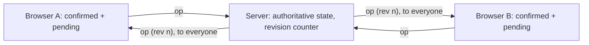

# Real-time collaboration

How CollabBoard keeps several open sessions in sync: the protocol, optimistic updates and reconciliation, and, most importantly, **what happens when two people change the same thing at the same time, what wins, and why.**

**Contents**

1. [Design in one page](#design-in-one-page)
2. [Operations](#operations)
3. [Protocol](#protocol)
4. [Optimistic UI and reconciliation](#optimistic-ui-and-reconciliation)
5. [What happens if two users edit the same card?](#what-happens-if-two-users-edit-the-same-card)
6. [Conflict rules for everything else](#conflict-rules-for-everything-else)
7. [Failure modes](#failure-modes)
8. [Security notes](#security-notes)
9. [Running and operating it](#running-and-operating-it)
10. [How it is tested](#how-it-is-tested)

---

## Design in one page

- Transport: **WebSocket** to a small Node server (`server/index.ts`, built on `ws`).
- Every user action is a serializable **operation**. A pure function, `applyOperation(state, op)`, applies it. The browser and the server run the **same function**.
- The server is the **single source of order**. It applies operations as they arrive, numbers them (revision 1, 2, 3, …) and broadcasts each accepted operation to every client, including the sender (which treats it as an acknowledgement).
- Clients are **optimistic**: they apply their own change immediately, show it, and reconcile when the server's order comes back.
- Because the reducer is deterministic and every client applies the same operations in the same order from the same starting snapshot, **every client converges to the same state.**



## Operations

Defined in `src/realtime/operations.ts` and shared by client and server.

| Type | Carries | Notes |
|---|---|---|
| `board.create` / `board.delete` | the board / board id | Delete cascades to columns, cards and comments |
| `column.add` / `column.rename` / `column.delete` | column / id and title / id | Delete cascades to cards and comments |
| `card.create` | the whole card (id included) | Appended to its column |
| `card.update` | card id and a **patch of only the changed fields** | Field-level merge |
| `card.move` | card id, target column, `afterCardId` (or `null` for top) | Anchored, not indexed |
| `card.delete` | card id | Cascades to the card's comment thread |
| `comment.add` | the whole comment (id, parent, author included) | Top-level or reply |
| `comment.edit` / `comment.delete` | comment id, `authorId`, body | Only the author's id is accepted; delete leaves a tombstone |

Every operation also carries `opId` (unique), `at` (ISO time of the user's action) and `by` (display name). IDs, timestamps and names are created **before** the operation is sent, never inside the reducer, which is what keeps the reducer deterministic.

Every case of the reducer returns the **same state reference** when nothing changes. That makes duplicates and stale operations harmless and free.

## Protocol

JSON text frames over one WebSocket (`src/realtime/protocol.ts`). Incoming messages are checked for shape before use; anything malformed is ignored.

**Client to server**

| Message | Meaning |
|---|---|
| `{ type: 'hello', seed }` | "I connected (or lost track), send me the state." `seed` is the client's own copy and is only used if the server is empty |
| `{ type: 'op', op }` | A change the user made |

**Server to client**

| Message | Meaning |
|---|---|
| `{ type: 'snapshot', rev, state }` | The full authoritative state at revision `rev` |
| `{ type: 'op', rev, op }` | An accepted change, at revision `rev`. Sent to everyone, including the author |
| `{ type: 'noop', opId }` | The server changed nothing for this operation (duplicate, or it no longer applies) |

**Server behaviour**

1. On `hello`: if the server is empty and the client sent a non-empty seed, adopt it (revision 1) and broadcast; otherwise reply with the current snapshot.
2. On `op`: if the `opId` was already seen (the last 5,000 are remembered), reply `noop`. Otherwise apply it with `applyOperation`. If nothing changed, reply `noop`. If it changed, increment the revision and broadcast `op`.
3. Safety: payloads over 1 MB are refused, the page `Origin` must be in `ALLOWED_ORIGINS` (when set), and a malformed operation that makes the reducer throw is treated as a no-op instead of crashing the server.
4. Liveness: a ping every 30 seconds; connections that do not answer are terminated.
5. `GET /health` answers `ok` for the host's health check and uptime monitors.

## Optimistic UI and reconciliation

Each client (`src/realtime/syncEngine.ts`) keeps:

- **`confirmed`:** the server's state as far as this client has been told, built only from the server's snapshot and operations, in the server's order.
- **`pending`:** this client's own operations the server has not acknowledged yet.
- **On screen:** `confirmed` with `pending` replayed on top.

```text
local action        -> apply to the screen right away; append to pending; send
server op (own)     -> it is the acknowledgement: apply to confirmed, remove from pending.
                       The screen already shows this result, so no store write, no re-render
server op (other)   -> apply to confirmed, replay pending on top, update the screen
server noop         -> remove that operation from pending and replay: its optimistic effect rolls back
server snapshot     -> replace confirmed, replay pending, re-send pending (the server ignores duplicates)
revision gap (n+2)  -> we missed something: ask for a fresh snapshot
```

The interaction is never waiting on the network, and the final state is decided by the server's order, not by arrival order at any one browser.

**Keyboard drag previews** are the one thing that deliberately bypasses this: moving a card with arrow keys changes only the local screen (`local: true`, never added to `pending`), and the drop sends one operation.

## What happens if two users edit the same card?

**Short answer.** Edits are compared **field by field**, not card by card. If they touched different fields, both edits survive. If they touched the same field, **the one the server received last wins.** If one of them deleted the card, **the delete wins.** The server is the single place that decides the order, so every client ends with the same result.

### Walkthrough: the same field

Alice and Bob both have the card "Draft" open.

| Time | Alice | Bob | Server |
|---|---|---|---|
| 1 | Sets the title to "Alpha". Her screen shows Alpha at once | | |
| 2 | | Sets the title to "Beta". His screen shows Beta at once | |
| 3 | | | Receives Alice's change first: revision 10 |
| 4 | | | Receives Bob's change second: revision 11 |
| 5 | Gets rev 10 (her own, acknowledged, nothing to redraw). Then rev 11 (Bob's): her card now shows **Beta**, and a toast says Bob edited the card | Gets rev 10 (Alice's): his confirmed title becomes Alpha, his pending "Beta" is replayed on top, so his screen still shows **Beta** (no flicker). Then rev 11 (his own): acknowledged | |

Everyone ends on "Beta": Bob's change reached the server last.

### Walkthrough: different fields

Alice edits the title while Bob edits the tags on the same card. Each edit sends only the fields that person changed (`{ title }` and `{ tags }`), so the server applies both and every card ends with the new title **and** the new tags. This also holds when both have the edit dialog open at the same moment: the dialog remembers what the card looked like when editing began and sends only what *you* changed, rather than re-sending a stale copy of everything else.

### Walkthrough: edit versus delete

Alice has the edit dialog open while Bob deletes the card. Whichever order the server receives them in, the card ends up deleted: an edit to something that no longer exists has nowhere to land, so it does nothing. Alice's dialog closes, focus returns to the board heading, and a toast says who deleted which card. Undo can bring the card back.

### Why these rules

| Alternative | Why it was not chosen |
|---|---|
| **Compare wall-clock timestamps** ("newest edit wins") | Browser clocks disagree and can be set to anything, so "newest" is not reliable. Timestamps are only displayed, never used to decide |
| **Reject the later edit with an error** ("first write wins") | The person who lost sees an error for work they thought was saved. Frustrating, and still needs a retry story |
| **Lock the card while someone edits it** | Blocks collaboration, and needs timeouts and recovery when a locker disconnects |
| **Operational transforms or CRDTs** | The right tool for co-editing long text character by character. Heavier than needed for structured fields. Flagged as the next step for card descriptions |
| **Server order plus field-level merge (chosen)** | One authority gives one order, so all clients converge. Field-level patches mean people rarely overwrite each other. The rules are simple enough to explain, and to test |

**Why delete wins:** resurrecting a card someone deliberately removed is more surprising than dropping a late edit, and an edit has no meaning without the thing it edits. The deletion is recoverable with undo.

### The honest limits

- If two people change the **same field** at the same instant, one change is silently replaced. That is acceptable for a title or a tag list and not for a long description; that is the case for a text CRDT.
- The person whose change lost is not shown a "your edit was overwritten" message, only the new value (and the notice that someone else edited the card).
- There is no per-card "someone is editing" indicator yet.

## Conflict rules for everything else

| Situation | Outcome | Rule |
|---|---|---|
| Two moves of the same card | The move the server received last wins | Moves are anchored to a neighbouring card, so they stay correct when other cards were inserted meanwhile |
| A move whose anchor card was deleted or moved away | The card goes to the end of the column | Fallback so a move never fails |
| Move into a column that was just deleted | Depends on the server's order. If the column delete came first, the move is ignored and the card stays where it was. If the move came first, the card is then deleted along with the column | Delete cascades; a move to a missing column is ignored. A known sharp edge (see technical debt) |
| Two cards created in one column | Both survive, in server order | Creation never conflicts |
| Card created in a column that was just deleted | Dropped | There is no column to put it in |
| Reply to a comment that was just deleted | The reply is kept, under a "deleted" placeholder | Tombstones keep threads intact |
| Edit of a comment that was just deleted | Ignored | Delete wins |
| Edit or delete of someone else's comment | Ignored | Only the author's id is accepted |
| Delete of something already deleted | Nothing happens (`noop`) | Idempotent |
| The same operation delivered twice | Nothing happens (`noop`) | `opId` dedupe on the server, idempotent reducer |

### Why everyone converges

Take any two clients. Each starts from the same server snapshot and then applies exactly the same operations in exactly the same order (the server's revision order), using the same deterministic reducer. Their `confirmed` states are therefore identical at every revision. What is on each screen differs only by that client's own not-yet-acknowledged operations, which are removed as the acknowledgements arrive. When all operations have been acknowledged, screens equal `confirmed`.

## Failure modes

| What happens | How the system behaves |
|---|---|
| **Connection drops** | The pill shows "Offline". The user can keep working; operations queue in `pending`. The client reconnects with exponential backoff (0.5 s growing to 10 s, with random jitter so a restart does not make everyone reconnect in lockstep) |
| **Reconnect** | `hello`, then a snapshot; pending operations are re-sent and the server drops duplicates by `opId` |
| **An operation arrives twice** | Server: `noop` reply. Client: ignores revisions it already has. The reducer is idempotent anyway |
| **A message is missed** (revision jumps) | The client notices the gap, marks itself unsynced and asks for a fresh snapshot |
| **The server restarts** | State is empty. The first client to reconnect seeds it from its local copy; everyone else receives that snapshot |
| **The free-tier host is asleep** | The pill shows "Connecting…". After 8 seconds the loading skeleton gives way to whatever is stored locally, and syncing starts as soon as the host wakes |
| **A bad message** (invalid JSON, unknown type, wrong shape) | Ignored. Oversized frames are refused by the socket |
| **An operation that makes the reducer throw** | Treated as a `noop`; the server keeps running |
| **A page from another origin** | Closed with code 1008 when `ALLOWED_ORIGINS` is set |
| **A dead peer** | The 30 second ping terminates connections that stop answering |
| **The server rejects an operation** (`noop`) | The client removes it from `pending` and replays, which rolls back its optimistic effect |

## Security notes

This is a simulation of the architecture, not a hardened service. Known gaps, all listed in [ARCHITECTURE_EVOLUTION.md](ARCHITECTURE_EVOLUTION.md#technical-debt):

- No authentication. Identity is an anonymous per-tab name.
- The server checks message shape but trusts `authorId` and `by` from the client, so author-only comment rules are enforced in the reducer against a value the client supplies.
- The origin allow-list stops other websites from using the socket from a browser, but it is not authentication (any non-browser client can set an `Origin` header).
- No rate limiting beyond the payload cap.
- Everyone shares one workspace.

## Running and operating it

```bash
pnpm dev:server    # ws://localhost:8787, restarts on change
pnpm server        # what the host runs
pnpm typecheck:server
```

| Variable | Where | Purpose |
|---|---|---|
| `VITE_WS_URL` | App build | Socket URL (`ws://localhost:8787` locally, `wss://…` in production). Unset means local-only |
| `PORT` | Server | Listening port (the host provides it) |
| `ALLOWED_ORIGINS` | Server | Comma-separated allowed page origins; empty allows any |

Deployed: the app on Vercel, the server on Render (free web service; start command `pnpm run server`). `/health` is suitable for an uptime monitor, which also keeps the free tier from sleeping.

## How it is tested

Automated (`pnpm test`):

- The reducer rules above, one by one: field-level merge, same-field last-wins, edit-after-delete, anchored moves surviving a concurrent insert, idempotent duplicates, cascades, tombstones, author-only comment edits (`operations.test.ts`, `comments.test.ts`).
- Undo/redo as operations, including "undo leaves a teammate's edit alone" (`commands.test.ts`).
- Keyboard drag sends nothing while previewing and exactly one operation on drop (`BoardPage.test.tsx`).

Manual, in two browsers: create, move and comment in one and watch the other; stop the server and keep editing; restart it and watch the clients reconnect; seed 600 operations from the performance lab and check the other window shows three notices and a summary.

**Not covered by automated tests:** the sync engine and transport themselves (they are exercised through the reducer tests and by hand). A two-client integration test with an in-process fake transport is the first test I would add next.